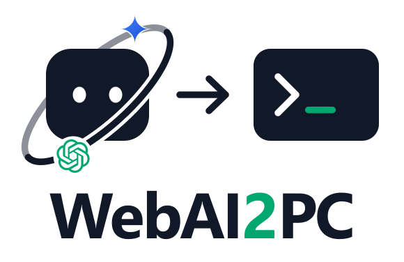
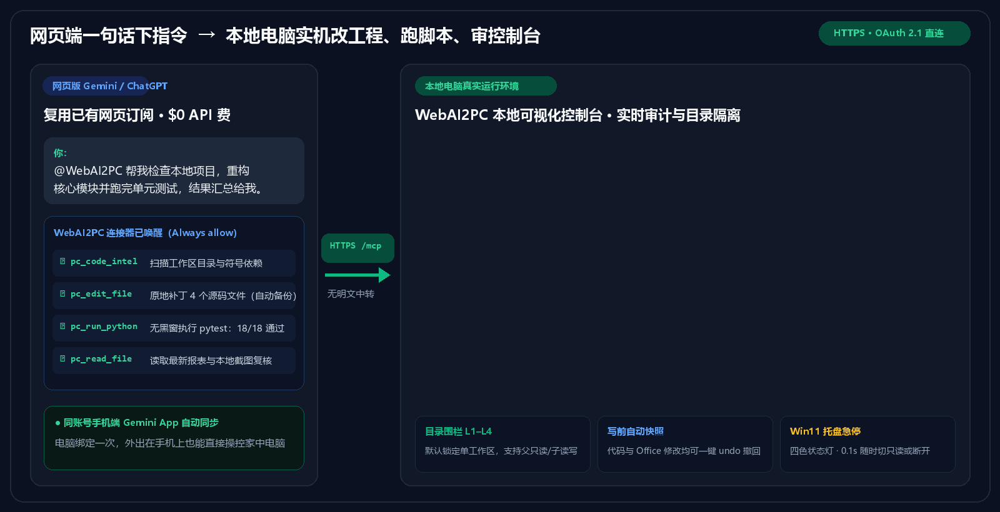
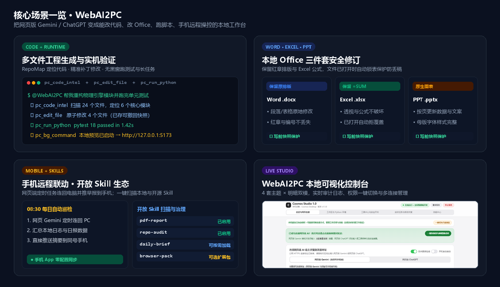
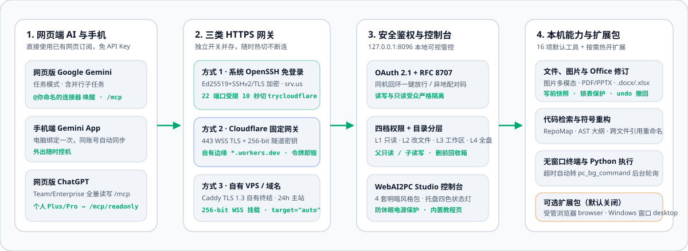
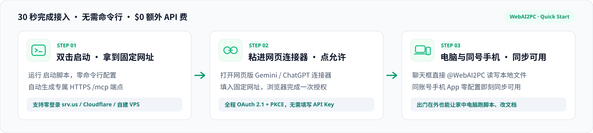
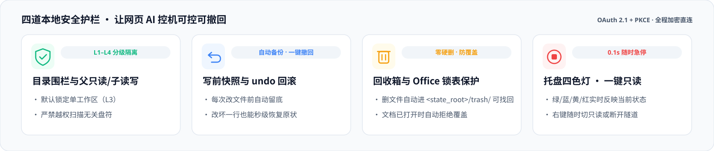
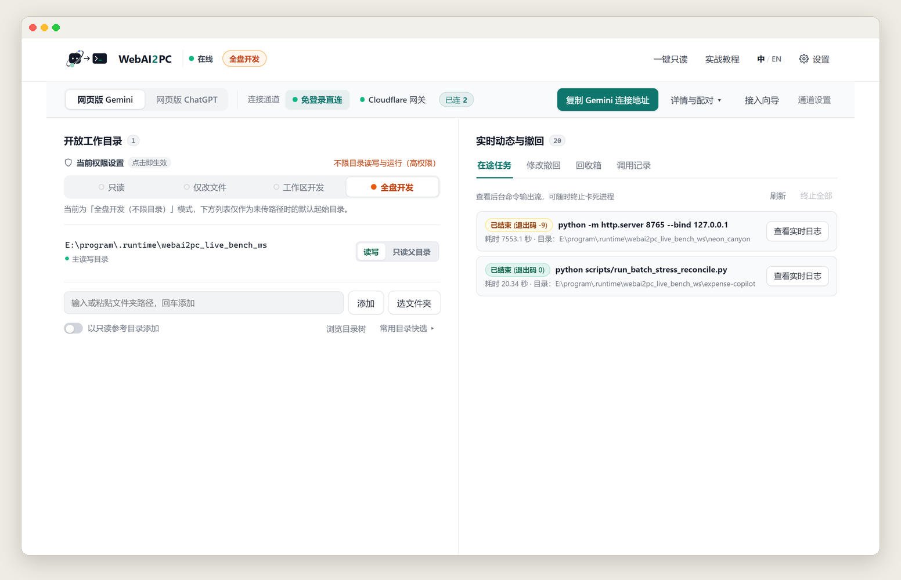
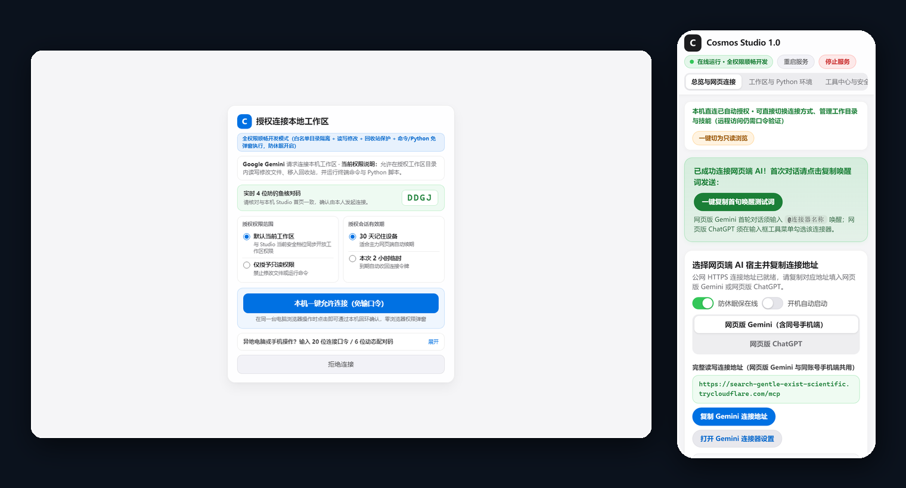

<div align="center">

<picture>
  <source media="(prefers-color-scheme: dark)" srcset="assets/brand/webai2pc-logo-dark.svg" />
  <source media="(prefers-color-scheme: light)" srcset="assets/brand/webai2pc-logo-light.svg" />
  
</picture>

<p><strong>把已买的网页版 Gemini / ChatGPT 会员，变成你的本地电脑助手 · $0 额外 API 账单</strong></p>

<p>
  <a href="https://github.com/cosmosomo/WebAI2PC/releases"></a>
  <a href="LICENSE"></a>
  
  
</p>

<p>
  <a href="#一核心场景与主要功能">核心场景</a> ·
  <a href="#二支持宿主范围与连接原理">连接原理</a> ·
  <a href="#三30-秒上手与-3-类连接方式">30 秒上手</a> ·
  <a href="#四默认-16-项核心工具standard-标准预设">16 项工具</a> ·
  <a href="#五安全兜底目录分层与可选扩展包">安全护栏</a> ·
  <a href="#六文档导航">教程导航</a>
</p>

</div>

<p align="center">
  
</p>

**WebAI2PC** 是运行在个人电脑或自有云服务器上的本地 MCP（Model Context Protocol）服务端与可视化控制台，专门面向 **网页版 Google Gemini（任务模式，含同账号手机端 Gemini App）** 与 **网页版 ChatGPT（对话模式）** 两个远程连接场景。它将授权工作目录内的文件读写、Word 与 Excel 文档修订、代码符号检索、无窗口终端命令、Python 执行、跨会话协作记录，以及可选的受管浏览器和桌面窗口操控工具，通过标准 HTTPS OAuth 2.1 连接器提供给网页端 AI 调用。

## 一、核心场景与主要功能

<p align="center">
  
</p>

1. **直接使用已有网页订阅处理本机工程**：通过 Google AI Pro / Ultra 或 ChatGPT 网页订阅读取本地代码、修改文件与运行测试，免去按调用量单独配置 API 计费密钥。
2. **云端并行子任务与大上下文支持**：在网页版 Gemini 任务模式中可将跨目录检索、多模块对比与测试排查拆分为多路异步子任务（`invoke_subagent`）并行执行，中间输出留在子任务内。
3. **手机端同步控机与多设备路由**：电脑端在网页版 Gemini 绑定一次连接器后，同账号手机端 Gemini App 自动同步可用；支持通过不同 `tool_prefix`（如 `desk_`、`laptop_`）挂载多台设备，或在自有服务器主站下用单入口 `target="auto"` 按路径自动转发到服务器或本地电脑。
4. **Word、Excel、PPT、PDF 与本地图片直接处理**：`pc_read_file` 支持网页端 AI 直接查看本地清晰图片（自动封装二进制图像数据），并支持提取 PDF、`.docx`、`.xlsx`、`.pptx` 文本；`pc_edit_file` 支持保留段落样式直接替换 `.docx` 正文与表格文字、按单元格坐标修改 `.xlsx` 数值或公式，遇到文件被 Word 或 Excel 打开占用时自动拦截保护并支持 `undo` 撤回。
5. **耗时命令自动转后台与笔记本电源保护**：运行超过同步等待阈值的编译或测试会自动转为 `pc_bg_command` 后台任务并返回 `job_id`；Windows 系统提供托盘四色状态灯，防休眠功能在接入交流电源时保持在线，笔记本改用电池供电时自动解除防休眠并在唤醒后自动重连。

## 二、支持宿主范围与连接原理

<p align="center">
  <picture>
    <source media="(prefers-color-scheme: dark)" srcset="assets/readme/architecture-dark.svg" />
    <source media="(prefers-color-scheme: light)" srcset="assets/readme/architecture-light.svg" />
    
  </picture>
</p>

| 目标网页宿主 | 账号条件 | 连接端点与调用方式 |
| :- | :- | :- |
| **网页版 Google Gemini 与手机端 Gemini App** | 年满 `18+` 周岁的 Google AI Pro / Ultra 订阅账号，或已开启自定义连接器权限的 Google Workspace 账号 | 绑定主地址 `https://<域名>/mcp`，在连接器详情页将 `App actions` 设为 `Always allow（始终允许）`，对话首句输入 `@Cosmos ...` 唤醒工具。 |
| **网页版 ChatGPT（工作区账号）** | Team / Business / Enterprise / Edu 工作区账号 | 绑定主地址 `https://<域名>/mcp`，在聊天输入框工具图标菜单中勾选连接器后调用读写与执行工具。 |
| **网页版 ChatGPT（个人订阅账号）** | 个人 Plus / Pro 订阅账号（平台仅允许自定义连接器暴露只读工具） | 绑定只读地址 `https://<域名>/mcp/readonly`，在聊天输入框工具图标菜单中勾选连接器后查阅本地代码与文档。 |

## 三、30 秒上手与 3 类连接方式

<p align="center">
  <picture>
    <source media="(prefers-color-scheme: dark)" srcset="assets/readme/steps-dark.svg" />
    <source media="(prefers-color-scheme: light)" srcset="assets/readme/steps-light.svg" />
    
  </picture>
</p>

### 一键复制给任意 Gemini / ChatGPT，让 AI 手把手带你配好

如果你第一次使用，可以直接复制下方整段提示词发给**任何一个网页版 Gemini 或网页版 ChatGPT**（即使还没绑定连接器也能用），让 AI 对照最新公开教程一步步带你完成配置：

```text
请做我的 WebAI2PC 配置向导，先读取官方公开配置教程全文（支持联网请直接访问 https://raw.githubusercontent.com/cosmosomo/WebAI2PC/main/docs/AI_SETUP_GUIDE.md 或 https://github.com/cosmosomo/WebAI2PC/blob/main/docs/AI_SETUP_GUIDE.md ），再按以下核实摘要一步步带我配通（先问清我的电脑系统、是否已下载解压、准备连网页版 Gemini 还是 ChatGPT，每次只教当前这一步，不要一次刷满屏）：
1. 下载解压：去 https://github.com/cosmosomo/WebAI2PC/releases 下载（Windows 免装 Python 选 win64-full.zip，已装 Python 3.10+ 或 macOS/Linux 选标准 zip），必须先完整解压缩到普通文件夹，再双击 一键启动_Cosmos_MCP.bat（macOS/Linux 运行 ./start_cosmos_mcp.sh），浏览器会自动打开本地控制台 http://127.0.0.1:8096/ 。
2. 首次免注册直连：控制台默认开启「第 1 类：一键上手免登录直连」（自动生成 https://*.srv.us/mcp 或 *.trycloudflare.com/mcp）；复制连接地址（ChatGPT 个人 Plus/Pro 账号点「复制只读」用 /mcp/readonly）。
3. 绑定网页端：Gemini 打开左侧 Customize -> Connectors -> + Custom，名称填 Cosmos 并粘贴 /mcp 地址（Client ID/Secret 留空），授权页点「本机一键允许连接」，再进连接器详情把 App actions 设为 Always allow，新对话首句发 @Cosmos 唤醒；ChatGPT 在 Settings -> Connectors 添加地址并在输入框工具菜单勾选 Cosmos。
4. 升级 Cloudflare 免费终身固定网址：点控制台右上角「设置 -> 连接与网关」（http://127.0.0.1:8096/#settings/gateways）展开第 2 类「Cloudflare 专属固定网关」，点「第 1 步：打开 Cloudflare 预填权限页」登录并点 Continue to summary -> Create Token，复制令牌粘回「第 2 步」（可顺手选填自定义域名），点「一键部署并开启（约 3 秒）」获得终身固定 *.workers.dev/mcp 地址（令牌部署后自动销毁；若首次打开 workers.dev 授权页慢可临时切全局代理 10 秒）。
5. 目录与 4 档权限：在主控首页左栏点「选文件夹」改工作目录（可开「以只读参考目录添加」做父只读子读写分层），按需点选「只读 / 仅改文件 / 工作区开发 / 全盘开发」四档权限。
6. 已连上后自动开页引导：一旦我已经绑好 @Cosmos，请提醒我可以直接对 @Cosmos 说「@Cosmos 帮我在电脑上打开网关设置页，教我怎么配 Cloudflare 固定网址」（已连上的 @Cosmos 可调用 pc_get_status(guide="cloudflare", open_page="gateways") 帮我弹出设置页，或调用 pc_skill_hub(action="load", skill="webai2pc-setup-tutorial") 读取完整内置教程）。
现在请先问我 3 个简短问题确认起点，带我开始第 1 步。
```

### 第 1 步：选择发行包、完整解压并双击启动

发布页提供两种发行压缩包，请按本机环境选择并**先将压缩包完整解压到桌面或任意文件夹**（请勿直接在压缩包预览窗口内双击脚本）：
- **完整离线绿色包 `Cosmos-MCP-v1.2.1-win64-full.zip`（推荐普通 Windows 用户）**：内置 `Python 3.12` 免安装运行环境与核心依赖，无需在本机预先安装 Python，完整解压后直接双击运行即可。
- **标准轻量包 `Cosmos-MCP-v1.2.1.zip`（适合已安装 Python 3.10~3.14 的开发者及 macOS / Linux 用户）**：体积小巧，启动时自动扫描本机已安装的官方 Python `3.10` 至 `3.14`、Conda 或 `uv` 环境（自动跳过微软商店 `WindowsApps\python.exe` 空壳）并准备独立 `.venv`。

Windows 双击解压后文件夹内的 `一键启动_Cosmos_MCP.bat`（macOS 与 Linux 运行 `./start_cosmos_mcp.sh`）。首次无配置启动默认创建并开放 `~/CosmosWorkspace` 目录，随后自动打开 **WebAI2PC 本地控制台**。

### 第 2 步：在控制台按需开启 3 类连接方式（支持多网关独立开关并存）

3 张连接卡片右上角均提供独立开关与实时状态标签，已连上一路网关时可同时开启测试另一路网关，互不断连：

1. **方式 1：一键上手就能用（默认推荐首次体验）**
   - 零登录开箱即连，默认通过本机持久密钥连接免登录固定网址（`https://*.srv.us/mcp`，关机重启网址不变）；若当前网络封锁 22 端口，4 秒内自动切换至内置免注册快速通道（`*.trycloudflare.com`）生成可用 HTTPS 地址，也可在卡片内手动切换子模式。
   - 在同一台电脑的浏览器中点击网页端连接跳转时，授权页通过顶层回环桥接支持一键点击允许绑定，免去手动输入连接口令；若当前处于临时快速通道，电脑重启后域名会更新，可切回免登录固定网址或同时开启方式 2、方式 3。
2. **方式 2：登录 Cloudflare 注册一下就行（无服务器长期固定网址）**
   - 点击控制台提供的预填权限令牌链接登录 Cloudflare，复制粘贴一次 API 令牌，约 3 秒内自动认领 `*.workers.dev` 子域并部署免费云端休眠中继网关（基于 Cloudflare Workers 与 SQLite Durable Object）。
   - 部署后获得终身固定的 HTTPS 连接地址，API 令牌在部署完成瞬间清零销毁；后续可直接拨动卡片右上角开关启停连接，无需重填令牌。
3. **方式 3：自己的服务器和域名（24 小时主站或自有固定域名）**
   - **一键部署自有服务器主站**：填写 Linux 云服务器公网 IP，支持使用 SSH 密码、填写本地 SSH 私钥路径或勾选本机默认 SSH 密钥免密登录（可选填自有域名，无域名时自动配置公网证书），一键部署 24 小时常驻主站，单个连接器可同时操作云服务器与挂接的本地电脑，本地电脑关机时返回离线状态提示。
   - **绑定自有固定域名**：也可直接填入 Cloudflare Named Tunnel 的 `--tunnel-token` 与绑定域名，或填入已配置反向代理的自有 HTTPS 域名。

命令行快速启动示例：

```bash
# 免配置快速体验
cosmos-mcp start --workspace D:\Projects\my-app

# 使用 Cloudflare Named Tunnel 固定域名并注册登录自启
cosmos-mcp start --mode cloudflare_token --tunnel-token <TOKEN> --public-url https://mcp.example.com --autostart
```

### 第 3 步：完成网页端绑定与首句唤醒

1. **网页版 Gemini 绑定与 `@Cosmos` 唤醒**：
   - 打开网页版 Gemini，在左侧栏依次点击 `Customize（自定义） -> Connectors（连接器） -> + Custom（添加自定义）`，名称填写 `Cosmos`，URL 粘贴控制台显示的 `https://<你的域名>/mcp`（`Additional settings` 中的 `Client ID` 与 `Client Secret` 留空）。
   - 跳转到授权页后，同机浏览器直接点击允许即可完成绑定；异地或手机浏览器核对页面显示的配对码或输入连接口令后确认。
   - 在连接器详情页点开 `Cosmos`，将 `App actions` 总开关设为 `Always allow（始终允许）`（请勿在对话流弹出的单张工具确认卡片上单独点允许，以免覆盖同连接器其余工具的免审批状态），并在控制台点击「复制 AI 操作守则（推荐存入 Skills）」（或复制 [host_skills/SKILL.md](host_skills/SKILL.md)）保存到左侧栏 `Customize（自定义） -> Skills（技能）`。
   - 新建对话后，**首句输入 `@Cosmos 帮我看看当前工作目录里有哪些文件`**（敲 `@Cosmos` 后点选弹出的 `Cosmos` 连接器标签，也可直接在控制台点击「一键复制首句唤醒测试词」或托盘菜单点击「复制首句唤醒词」）即可调用本机工具。
2. **网页版 ChatGPT 绑定与勾选唤醒**：
   - 在网页版 ChatGPT `Settings（设置） -> Connectors（连接器）` 设置中新增自定义连接器，名称填写 `Cosmos`，工作区账号填写 `https://<你的域名>/mcp`，个人 Plus / Pro 账号填写 `https://<你的域名>/mcp/readonly` 并完成授权。
   - 新建对话时，**点击输入框下方的工具图标并勾选已绑定的 `Cosmos` 连接器**，即可直接发消息读写或查阅本地项目。

## 四、默认 16 项核心工具（`standard` 标准预设）

默认工具前缀为 `pc_`（单台电脑保持默认 `pc` 即可；多设备同时接入同一窗口时可在控制台或通过 `--tool-prefix <名称>` 热修改工具前缀，注：`--prefix` 参数用于同一台电脑运行多实例时的配置槽位隔离；单入口多节点模式下所有工具均支持 `target="auto"` 按路径自动路由）：

| 工具名称 | 类别 | 功能说明 |
| :- | :- | :- |
| `pc_get_status` | 只读查询 | 查看系统信息、读写与只读工作目录、技能计数、安全档位，支持传 `job_id` 与 `wait_seconds` 轮询后台任务。 |
| `pc_find_files` | 只读查询 | 按通配符、扩展名、目录深度与排序方式查找工作区文件与子目录。 |
| `pc_search_code` | 只读查询 | 跨文件正则或字面量检索代码与结构化文档，返回匹配行号与所在符号上下文。 |
| `pc_code_intel` | 代码理解与重构 | 提取工程概览、文件符号大纲、符号定义、跨文件引用、语法诊断及按作用域重命名符号（`outline\|overview\|repo_map\|symbol\|refs\|diagnostics\|rename_symbol`）。 |
| `pc_read_file` | 只读查询 | 按行号或符号名分段读取文件、直接让 AI 查看本地清晰图片（自动封装二进制图像资源），并提取 PDF、`.docx`、`.xlsx`、`.pptx` 文本。 |
| `pc_batch_probe` | 只读查询 | 在受限只读沙盒内单次运行确定性 Python 聚合探针（预置 `PROJ`、`rg`、`outline`、`list_dir` 与 `RESULT`）。 |
| `pc_web_research` | 只读查询 | 本地执行公开网页与 GitHub 代码检索（`search\|github_search\|fetch`），避免主会话混调宿主内置联网搜索导致免审批状态降级。 |
| `pc_skill_hub` | 只读查询 | 检索工作区 `.agents/skills`、内置守则与受管技能库（默认关闭宿主全局技能扫描 `scan_host_global_skills` 以防串读外部目录）。 |
| `pc_edit_file` | 文件与文档修改 | 对代码文本做单处或多处上下文替换，并支持直接修订 `.docx` 段落表格文字与 `.xlsx` 单元格（遇 Office 打开锁表返回 `ERR_OFFICE_FILE_LOCKED` 保护，写前自动留存快照）。 |
| `pc_write_file` | 文件修改 | 新建文件、覆盖写入或追加文本，写前自动留存可撤回快照并执行语法检查。 |
| `pc_manage_files` | 文件管理 | 管理目录与文件（`mkdir\|move\|rename\|copy\|trash\|restore\|undo\|redo\|list`），删除操作统一移入可恢复回收箱。 |
| `pc_workspace_memory` | 协作记录 | 在外部 SQLite 库中读写跨会话工作区交接记录（`read\|post\|search`），不向代码仓库写入隐藏文件。 |
| `pc_skill_manage` | 技能管理 | 在受控目录内列出、创建、更新或移入回收箱管理本地 `SKILL.md` 技能。 |
| `pc_run_command` | 命令运行 | 后台无窗口执行终端命令，超同步等待阈值的耗时任务自动转为 `pc_bg_command` 后台任务。 |
| `pc_run_python` | 命令运行 | 通过标准输入直接执行多行 Python 代码，支持指定虚拟环境或 Conda 解释器。 |
| `pc_bg_command` | 命令运行 | 启动、查询状态、等待完成、读取尾部日志或终止后台长耗时任务（`start\|status\|wait\|list\|kill`）。 |

## 五、安全兜底、目录分层与可选扩展包

<p align="center">
  <picture>
    <source media="(prefers-color-scheme: dark)" srcset="assets/readme/safety-dark.svg" />
    <source media="(prefers-color-scheme: light)" srcset="assets/readme/safety-light.svg" />
    
  </picture>
</p>

### 1. 工作区读写分层与宿主技能默认隔离

- **原生选目录与父只读子读写分层**：控制台支持调起操作系统原生文件夹选择框，支持将外层总目录设为只读浏览（`readonly_workspace_roots`），同时将内部当前开发的子项目设为可读写（`workspace_roots`），按最长路径前缀自动匹配读写权限。
- **宿主全局技能默认隔离**：默认关闭宿主全局技能目录扫描开关（`scan_host_global_skills=False`），隔离本机 `~/.claude/skills`、`~/.codex/skills` 等外部工具目录，需要复用时可在控制台手动开启。

### 2. 可选外设扩展包（默认关闭，按需热开启）

可在控制台「工具中心与安全开关」开启，或运行 `cosmos-mcp permissions --enable-pack browser,desktop`：
- **受管浏览器包（`browser` -> `pc_browser_use`）**：使用独立 `<状态目录>/browser_profile` 目录运行，不触碰个人日常浏览器窗口；支持真实 DOM 可见性过滤、多标签页切换、文件下载至工作区及无焦点抢占的 `open_login_window` 登录窗口。
- **桌面窗口操控包（`desktop` -> `pc_cua_window`，仅 Windows 注册）**：基于离屏 `PrintWindow` 与 UIAutomation 执行后台窗口截图、缩放坐标自动反算点击、多输入框定位输入、组合快捷键与滚轮操作；非 Windows 系统启动时自动跳过该扩展包。

### 3. 四档安全模式与系统沙盒隔离

- **`L3` 工作区内顺畅开发（默认）**：允许在已开放的可读写工作目录内修改文件、移入回收箱、运行命令与 Python 脚本，在只读参考目录内仅允许查阅。
- **`L4` 全盘顺畅开发（不限目录）**：允许跨任意本地目录读写与执行，保留系统凭据目录隔离、回收箱保护及键鼠活跃自动礼让。
- **`L2` 仅改文件禁跑命令**：允许在可读写工作目录内读取与编辑文件，禁止命令执行与外设扩展包，切换时自动终止在途后台进程。
- **`L1` 只读浏览模式**：仅开放只读查询工具，控制台与系统托盘右键菜单均支持免口令一键切入。
- **容器与虚拟机隔离（`sandbox/`）**：提供非特权 Docker 配置（`sandbox/Dockerfile`、`sandbox/docker-compose.yml`）与一次性 Windows Sandbox 配置（`sandbox/CosmosMCP_WindowsSandbox.wsb`）；打包完整免安装绿色版可执行 `python -B scripts/build_release.py --embed-python-dir <官方python-embed解压目录>`。

### 4. 本地可视化控制台与同机授权界面实拍

<p align="center">
  
</p>

<details>
<summary>展开查看：同机一键 OAuth 2.1 授权页与移动端控制台实拍</summary>

<p align="center">
  
</p>

</details>

## 六、文档导航

### 1. 分场景实操教程矩阵（01～05）

| 编号与教程 | 适用场景与主要内容 |
| :- | :- |
| [01. 网页版 Gemini 与手机远程连接教程](docs/01_网页版Gemini与手机远程连接教程.md) | 裸机双击自举、3 类连接方式多网关独立开关并存、网页版 Gemini 任务模式绑定、`Always allow` 免审批总开关与手机端同步控机 |
| [02. 网页版 ChatGPT 工作区与个人只读接入教程](docs/02_网页版ChatGPT工作区与个人只读接入教程.md) | Team / Enterprise 工作区全量 16 项工具与个人 Plus / Pro 只读端点 `/mcp/readonly` 对比、[RFC 8707](https://datatracker.ietf.org/doc/html/rfc8707) 受众隔离、`stateless_http` 与同机回环免密放行 |
| [03. Cosmos Studio 面板与扩展包指南](docs/03_Cosmos_Studio面板与扩展包指南.md) | 本地可视化控制台五大功能页、4 档安全模式（含全盘顺畅开发）、只读参考目录分层、受管浏览器与桌面操控扩展包及系统沙盒隔离 |
| [04. 三大连接通道选型与网络排障手册](docs/04_三大连接通道选型与网络排障手册.md) | 3 类连接卡片独立开关同时在线、Cloudflare 免费 SQLite Durable Object 网关 3 秒部署与令牌销毁、自有服务器 SSH 密码或密钥一键建 24 小时主站与网络排障 |
| [05. 多智能体并行子任务与实战工作流教程](docs/05_多智能体并行子任务与实战工作流教程.md) | 宿主 Skills 守则导入、Gemini 任务模式 `invoke_subagent` 并行分工、PDF / `.pptx` / 图片多模态与 `.docx` / `.xlsx` 安全修订、`pc_bg_command` 后台轮询及外设扩展包运行边界 |
| [docs/AI_SETUP_GUIDE.md](docs/AI_SETUP_GUIDE.md) | 面向任意网页版 Gemini / ChatGPT 无编码直读的公开陪配单文件教程（含下载选包、免注册首连、Cloudflare 3 秒固定网关、4 档权限及 `@Cosmos` 自动打开本地设置页说明） |

### 2. 本地交互式教程中心、可换风格架构与工程规范

- **本地控制台内置交互式教程页**：启动服务后可直接访问 `http://127.0.0.1:8096/tutorials`（若默认端口被占用，以控制台实际运行端口为准），页面自动读取当前选中的就绪网关 `/mcp` 与 `/mcp/readonly` 地址及安全档位，支持按宿主类型分步复制配置并记录进度；在控制台与教程页顶栏右侧可一键切换 4 套明暗双模风格包与 4 套品牌 IP 图标转向姿态。
- [界面设计系统与风格扩展规范（.interface-design/system.md）](.interface-design/system.md)
- [项目架构与网页连接器维护规范（AGENTS.md）](AGENTS.md)
- [宿主操作守则模板（host_skills/SKILL.md）](host_skills/SKILL.md)
- [隐私政策与零遥测声明（PRIVACY.md）](PRIVACY.md)
- [安全架构与漏洞反馈说明（SECURITY.md）](SECURITY.md)
- [版本变更记录（CHANGELOG.md）](CHANGELOG.md)

## 七、开源许可

本项目基于 [MIT License](LICENSE) 开源发布，源码仓库位于 [https://github.com/cosmosomo/WebAI2PC](https://github.com/cosmosomo/WebAI2PC)。
