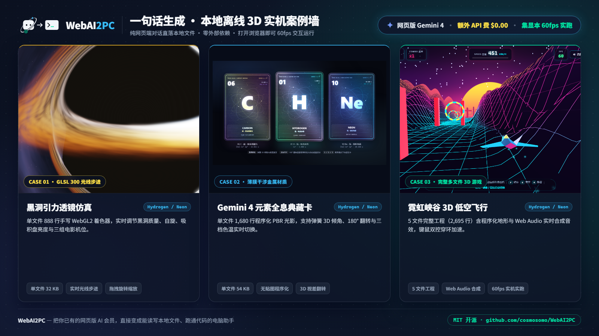

<div align="center">


<p><strong>把网页版 Gemini 与 ChatGPT（连普通 Chat 模式也能直接干活）接进本地电脑 · 避开客户端代理与智能体额度折腾 · $0 额外 API 账单</strong></p>

<p>
  <a href="https://github.com/cosmosomo/WebAI2PC/releases"></a>
  <a href="LICENSE"></a>
  
  
</p>

<p><strong>简体中文</strong> · <a href="README_EN.md">English</a> · <a href="docs/README.md">文档中心 (docs/)</a></p>

</div>

<p align="center">
  
  
</p>

> **AI Agent / 助手直达安装教程**：如果你是帮用户安装配置的 AI（Cursor、Claude Code、Codex、豆包工作、WorkBuddy 等），请直接读取 **[docs/AI_SETUP_GUIDE.md](docs/AI_SETUP_GUIDE.md)**（Raw 直链：`https://raw.githubusercontent.com/cosmosomo/WebAI2PC/main/docs/AI_SETUP_GUIDE.md`）。

**WebAI2PC** 是一个运行在个人电脑上的本地 MCP 服务端与可视化控制台。把启动后生成的 HTTPS 地址粘贴进 **网页版 Google Gemini**（含同账号手机端 Gemini App）或 **网页版 ChatGPT** 的自定义连接器，无需另买 API 密钥即可直接复用已有网页会员：接入网页版 ChatGPT 后，除 `Work` 模式长程与定时任务外，**连日常普通 `Chat` 模式也能直接调本地工具改多文件工程、原样修订 Word / Excel、提取 PPT 结构与文本、跑测试脚本，不消耗 `Work / Codex` 智能体额度**。

## 为什么用 WebAI2PC

| 对比维度 | 传统桌面客户端 / API 工具 | WebAI2PC（开源直连） |
| :- | :- | :- |
| **模型与费用** | 另买 API Key 每月多花 `$30–$100`，或受限于客户端额度 | **直接复用已有网页会员**（如 Gemini 4 系列、ChatGPT Team/Business 在 `Chat` 模式零智能体额度损耗直连），**`$0` 额外 API 费** |
| **安装与网络** | 卡代理、地区限制、配环境变量、换网断流 | **30 秒双击启动**，浏览器自带网络即开即用，免命令行 |
| **本地干活能力** | 网页 Chat 模式只能贴代码片段（或耗费 Work / Codex 额度），改文档易丢排版与公式 | **让 ChatGPT 普通 Chat 模式也能实跑本地多文件工程 + Office 原样保留排版/公式 + 定时任务推手机** |
| **安全边界** | 全盘高权限读写，误删改乱难回退 | **单目录隔离 · 改前自动快照一键撤回 · 删文件进回收站 · 托盘 0.1s 只读急停** |

## 30 秒上手

1. **下载并完整解压**：前往 [Releases 发布页](https://github.com/cosmosomo/WebAI2PC/releases) 下载发行包（Windows 免装 Python 选 `win64-full.zip`，其余环境选标准 `zip`），完整解压到普通文件夹。
2. **双击启动并复制地址**：Windows 双击 `一键启动_Cosmos_MCP.bat`（macOS / Linux 运行 `./start_cosmos_mcp.sh`），自动打开本地控制台 `http://127.0.0.1:8096/` 并生成免登录固定地址 `https://<域名>/mcp`（首次双击若弹出 Windows SmartScreen 蓝屏保护提示，点击「更多信息 -> 仍要运行」即可）。
3. **粘贴到网页端配置栏并点允许**（**注意：不要把 `/mcp` 地址直接粘贴到浏览器地址栏里打开；控制台复制出的连接地址与接入指令仅限填入本人登录的 AI 账号，请勿截图或粘贴发到群聊、公开帖子与 Issue**）：
   - **网页版 Gemini**：直接打开 [https://gemini.google.com/customize/connectors](https://gemini.google.com/customize/connectors)（或左下角菜单 `Personal Intelligence -> Connected Apps`），点右上角 `+ Custom`，把 `https://<域名>/mcp` 粘贴到 **`MCP Server URL`** 配置栏点 `Next` 授权，再把 `App actions` 设为 `Always allow`，新对话首句输入 `@Cosmos` 唤醒；同账号手机端 Gemini App 自动同步可用。
   - **网页版 ChatGPT（本机插件页直绑最快，日常干活用 `Chat` 省额度）**：首选在控制台网关就绪后点 **「复制地址并打开 ChatGPT 插件页」**，在已登录本机浏览器打开 `https://chatgpt.com/plugins` -> `＋ -> 添加自定义 MCP 服务器`（`Add custom MCP server`），名称填 `WebAI2PC`、认证选 `OAuth`，粘贴 `/mcp`（工作区全功能）或 `/mcp/readonly`（个人 Plus / Pro 只读），在授权页点「本机一键允许连接」并点击 `Install` 安装（遇到连接或 `403` 权限问题点旁侧 **「复制给 ChatGPT 接入 / 排障」**；装好后日常在普通 `Chat` 模式发 `@WebAI2PC` 零扣 `Work / Codex` 额度，长程多步交付与定时任务用 `Work` 模式发 `@WebAI2PC`，首次调用 `pc_get_status` 验证）。

### 懒得自己装？复制一句话发给你的 AI / Agent 帮你配好

直接把下面这句话发给 **Cursor、Claude Code、Codex、Windsurf、Trae、GitHub Copilot、Cline / Roo Code、Antigravity、Qoder、通义灵码、OpenCode、豆包电脑版 / 豆包工作、WorkBuddy、OpenClaw、Manus、网页版 Gemini、网页版 ChatGPT** 等任意 AI 助手（**有本机权限的 Agent 会自动帮你下载解压、启动服务并拿到 `/mcp` 地址；纯网页 AI 会一步步带你点完**）：

```text
请帮我安装并配置 https://github.com/cosmosomo/WebAI2PC ，先读取仓库里的 https://raw.githubusercontent.com/cosmosomo/WebAI2PC/main/docs/AI_SETUP_GUIDE.md ，如果你有本机命令权限请直接帮我下载解压并启动拿到 /mcp 地址，再一步步带我在网页版 Gemini 或 ChatGPT 里完成绑定。
```

> 就算只把仓库链接 `https://github.com/cosmosomo/WebAI2PC` 直接发给上述 Agent 说“帮我装这个”，它们打开首页第一屏也能直接定位到 [`docs/AI_SETUP_GUIDE.md`](docs/AI_SETUP_GUIDE.md)。注意：启动后生成的连接地址与接入指令仅限填入你本人登录的 AI 账号，请勿截图或粘贴发到群聊、公开帖子与 Issue。

## 连接通道前置依赖与代理说明

本地控制台内置 3 类连接卡片（支持独立开关同时在线），下载或切换通道前可按下表核对本机依赖与代理要求：

| 连接通道 | 本机环境与组件依赖 | 云端账号、配额与超时边界 | 网络与代理要求（含中国大陆实测边界） |
| :- | :- | :- | :- |
| **通道 1 默认：`*.srv.us`**<br>（免登录固定直连） | 仅依赖系统自带 OpenSSH（`ssh`）客户端与出站 TCP `22` 端口，零额外二进制 | 零注册，跨关机重启网址固定不变 | 国内家庭宽带通常**免代理直连**；封禁 `22` 端口的校园网/企业网会在 `4` 秒内自动回退至 `*.trycloudflare.com` |
| **通道 1 回退：`*.trycloudflare.com`**<br>（Quick Tunnel / `--mode cloudflare`） | 依赖官方 `cloudflared` 二进制；`PATH` 未预装时首次自动从 [GitHub Releases](https://github.com/cloudflare/cloudflared/releases/latest) 或 `COSMOS_CLOUDFLARED_MIRROR` HTTPS 镜像校验下载至状态目录 `bin/` | 零注册，**每次重启必换域名**；[官方无在线率 SLA](https://developers.cloudflare.com/tunnel/get-started/quick-tunnels/)，单控制流（`ha-connections:1`）重连有 `4–21s` 空窗（返 `530`/`1033`），限 `200` 并发在途请求与 `125s` 边缘读超时 | 国内无代理拉取 GitHub 较慢时，需开系统代理、配置 `COSMOS_CLOUDFLARED_MIRROR` 或预装 `cloudflared`；跨境高丢包环境建议开启系统 HTTP 代理降低断流率 |
| **通道 2：`Cloudflare 专属固定网关`**<br>（`workers_dev`） | 纯 Python 标准库 `443 WSS` 客户端，**零外部二进制依赖**（无需安装 `Node.js`、`wrangler` 或 `cloudflared`） | 免费 Cloudflare 账号 + 一次性最小权限 API Token（部署后本机立即清零销毁）；受 [Workers Free](https://developers.cloudflare.com/workers/platform/limits/) 每日 `100,000` 次请求上限（超限返 `1027`）及 [边缘默认 `125s` 反代读超时](https://developers.cloudflare.com/support/troubleshooting/http-status-codes/cloudflare-5xx-errors/error-524/) 约束 | **中国大陆默认 `*.workers.dev` 遭全量 DNS 污染（裸连 `100%` 超时），未绑自定义域名时本机运行期间须保持系统 HTTP/HTTPS 代理（Clash / Mihomo / v2rayN 或 `HTTPS_PROXY` / `WSS_PROXY`）常开且规则覆盖 `*.workers.dev`**（首次 `/consent` 授权时浏览器亦需走代理；若设 `NO_PROXY` 须保留 `127.0.0.1,localhost,::1`）。**国内免代理方案**：在通道 2 绑定同账号下自定义域名（Active Zone）即可免代理直连 |
| **通道 3 主推：自有云服务器 24h 主站**<br>（`vps_hub` / `vps`） | 本机 `ssh` 客户端 + 一台开放 `80`/`443` 端口的 Linux 服务器 | 复用自有服务器，**零 Cloudflare 依赖、零单日请求上限、零 `125s` 边缘超时限制**，电脑关机主站仍在线 | 国内（配已备案域名）或港新等海外服务器**全程免代理直连** |
| **通道 3 子项：`Cloudflare Named Tunnel`**<br>（`--mode cloudflare_token`） | 依赖官方 `cloudflared` 二进制（同上支持首次自动下载或 `COSMOS_CLOUDFLARED_MIRROR` 镜像） | 依赖 Cloudflare Zero Trust 账号、已激活托管域名（Active Zone）及后台指向 `http://127.0.0.1:8096` 的 Public Hostname 转发；受边缘 `125s` 读超时约束 | 自定义域名免受 `workers.dev` 污染；须在 Cloudflare 后台关闭 `Bot Fight Mode` 并对 `/mcp*` 与 OAuth 路径跳过托管质询，避免拦截 Google / OpenAI 云端请求 |

> 完整分步配置与排障细节请参阅 **[docs/04_三大连接通道选型与网络排障手册.md](docs/04_三大连接通道选型与网络排障手册.md)**。

## 一句话实机效果 · 复制提示词即刻复现

<p align="center"></p>

连好后无需外部图片、第三方库或 CDN，网页版 Gemini 开头加 `@Cosmos `、网页版 ChatGPT 普通 `Chat` 模式开头加 `@WebAI2PC `（`$0` 额外 API 费，零消耗 `Work / Codex` 额度），即可在本地工作目录直接生成文件并 60fps 运行（本地控制台首页与 `/tutorials` 第 4 章均支持一键复制）：

| 案例 | 本地生成产物 | 实机运行内容 |
| :- | :- | :- |
| **01 黑洞引力透镜仿真** | 单文件 `blackhole_studio.html` | 原生 WebGL2（GLSL 300）实时光线步进渲染发光吸积盘与引力透镜，带「俯瞰盘面 / 掠过视界 / 穿越光环」三组机位与 4 项实时物理滑块，离线 60fps |
| **02 元素全息金属典藏卡** | 单文件 `gemini_holo_cards.html` | 程序化 Canvas + 原生 WebGL2 薄膜干涉反光，`06 C / 01 H / 10 Ne` 三张 3D 典藏卡支持悬停弹簧倾角、点击 180° 翻转与三档色温环境光，离线 60fps |
| **03 霓虹峡谷 3D 低空飞行** | 5 文件工程 `neon_canyon/` | 自动生成 `index.html`、`styles.css`、`terrain.js`、`audio.js`、`game.js`，含合成波线框峡谷、穿环加速连击、Web Audio 实时合成音效与键鼠切换，离线 60fps |

<details>
<summary><strong>点击展开 3 个案例的一键复制提示词（Gemini 用 <code>@Cosmos </code> · ChatGPT 普通 Chat 模式用 <code>@WebAI2PC </code>）</strong></summary>

**01 黑洞引力透镜仿真 (`blackhole_studio.html`)**

```text
@Cosmos 在当前工作区写一个纯离线单文件 blackhole_studio.html，用原生 WebGL2（GLSL 300）实时光线步进渲染带发光吸积盘和引力透镜效果的黑洞；加上左键旋转、滚轮缩放，右侧做一个简洁的中文半透明控制面板，支持切换「俯瞰盘面 / 掠过视界 / 穿越光环」三组电影机位，以及黑洞质量、自旋、吸积盘亮度、时间流速四个实时滑块，写完后本地启动检查确认零报错。
```

**02 元素全息金属典藏卡 (`gemini_holo_cards.html`)**

```text
@Cosmos 在当前工作区写一个纯离线单文件 gemini_holo_cards.html，用原生 WebGL2 和程序化 Canvas 做出 3 张带薄膜干涉金属反光的 3D 全息典藏卡，主题为 Gemini 4 的 06 C（Carbon）、01 H（Hydrogen）、10 Ne（Neon）；支持鼠标悬停弹簧 3D 倾角与视差、点击 180° 翻转看背面、顶部切换「一字排开 / 聚焦单卡」以及三档色温环境光，不依赖任何外部图片和 CDN，写完后帮我本地打开验收。
```

**03 霓虹峡谷 3D 低空飞行 (`neon_canyon/`)**

```text
@Cosmos 在当前工作区新建 neon_canyon 目录，按多文件工程结构（index.html、styles.css、terrain.js、audio.js、game.js）写一个纯离线原生 WebGL2 3D 低空飞行游戏「霓虹峡谷低空飞行」：合成波落日与霓虹线框峡谷、穿越空中能量光环触发加速与连击、躲避赤红能量柱与峡谷绝壁，用 Web Audio 实时合成引擎和穿环音效，支持 WASD/方向键与鼠标自动切换、顶部显示得分/最高分/连击/空速/FPS 与暂停重开按钮，写完后本地运行验收无控制台报错。
```

> 在网页版 ChatGPT 普通 `Chat` 模式运行时，把开头的 `@Cosmos ` 换成 `@WebAI2PC ` 即可（控制台首页「一句话实机效果」折叠栏支持按当前 Gemini / ChatGPT 页签自动切换前缀复制）。

</details>

## 支持宿主范围

| 目标网页宿主 | 账号条件与模式分工 | 连接端点 |
| :- | :- | :- |
| **网页版 Google Gemini & 手机 App** | 年满 18 岁的 Google AI Pro / Ultra 或已开连接器权限的 Workspace 账号 | `https://<域名>/mcp`（全功能） |
| **网页版 ChatGPT（工作区账号）** | Team / Business / Enterprise / Edu（本机插件页 `chatgpt.com/plugins` 一键允许安装；装好后日常用 `Chat` 零扣 `Work / Codex` 额度，长程/定时任务用 `Work`） | `https://<域名>/mcp`（全功能） |
| **网页版 ChatGPT（个人订阅账号）** | 个人 Plus / Pro（平台对自建 MCP 仅开放 `read/fetch` 时绑此地址；装好后 `Chat` 与 `Work` 均可调 `@WebAI2PC`） | `https://<域名>/mcp/readonly`（只读） |

## 本地可视化控制台

<p align="center">
  
</p>

> 想看 **连接原理图、安全兜底图、16 项内置工具清单与移动端实拍**？请进入 **[二级文档中心（docs/）](docs/README.md)**。

## 二级教程与文档中心（[`docs/`](docs/README.md)）

| 文档 | 内容 |
| :- | :- |
| [01. 网页版 Gemini 与手机远程连接教程](docs/01_网页版Gemini与手机远程连接教程.md) | 下载启动、免审批总开关与手机端同步控机 |
| [02. 网页版 ChatGPT 工作区与个人只读接入教程](docs/02_网页版ChatGPT工作区与个人只读接入教程.md) | `/mcp` 全量模式与 `/mcp/readonly` 只读模式配置 |
| [03. 本地控制台面板与扩展包指南](docs/03_Cosmos_Studio面板与扩展包指南.md) | 4 档安全模式、目录分层、浏览器与桌面扩展包、Docker / Windows Sandbox |
| [04. 三大连接通道选型与网络排障手册](docs/04_三大连接通道选型与网络排障手册.md) | 免登录通道、Cloudflare 3 秒固定网关、自有 VPS 主站与排障 |
| [05. 多智能体并行与实战工作流教程](docs/05_多智能体并行子任务与实战工作流教程.md) | Skills 守则导入、Office 修订、多路并行子任务实战 |
| [AI 陪配单文件教程](docs/AI_SETUP_GUIDE.md) | 面向网页 AI 直读的公开配置教程 |

更多工程文档：[AGENTS.md](AGENTS.md) · [host_skills/SKILL.md](host_skills/SKILL.md) · [PRIVACY.md](PRIVACY.md) · [SECURITY.md](SECURITY.md) · [CHANGELOG.md](CHANGELOG.md)

## 开源许可

本项目基于 [MIT License](LICENSE) 开源发布。
