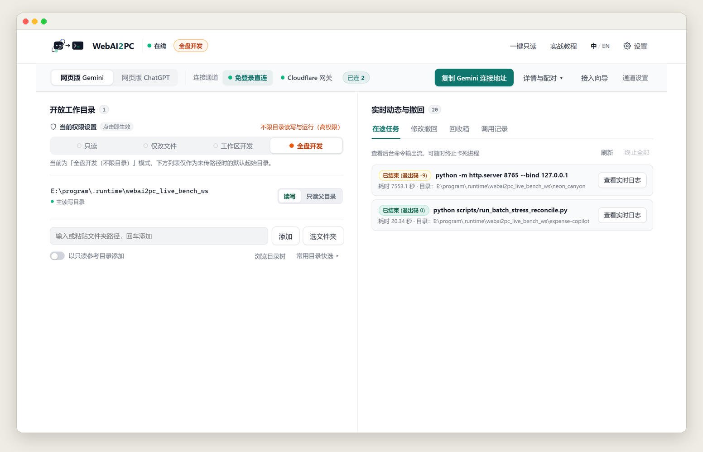

<div align="center">


<p><strong>Connect Web Gemini &amp; ChatGPT (even everyday Chat mode works as a local agent!) to your PC · Skip proxy &amp; Work/Codex quota hassles · $0 extra API bills</strong></p>

<p>
  <a href="https://github.com/cosmosomo/WebAI2PC/releases"></a>
  <a href="LICENSE"></a>
  
  
</p>

<p><a href="README.md">简体中文</a> · <strong>English</strong> · <a href="docs/README.md">Docs Hub (docs/)</a></p>

</div>

<p align="center">
  
  
</p>

**WebAI2PC** is a local MCP (Model Context Protocol) server and visual control console for your computer. Paste the generated HTTPS URL into a custom connector in **Web Google Gemini** (including the same-account mobile Gemini App) or **Web ChatGPT** with `$0` extra API keys: once connected to Web ChatGPT, **even everyday `Chat` mode (alongside `Work` mode) directly runs multi-file local projects, edits Office files with formatting/formulas intact, and runs tests without burning `Work / Codex` quota**.

## Why WebAI2PC

| Dimension | Desktop Clients / API Agents | WebAI2PC (Open Source) |
| :- | :- | :- |
| **Models & Cost** | Extra `$30–$100/mo` API keys or tight desktop quotas | **Reuse your existing web subscription** (Gemini 4, or ChatGPT Team/Business in `Chat` mode without burning `Work / Codex` quota), **`$0` extra API bills** |
| **Setup & Network** | Proxy issues, region blocks, env vars, session drops | **30-second double-click launch**, works over your browser's own connection, no CLI |
| **Local Execution** | Web `Chat` mode only pastes snippets (or burns `Work / Codex` quota), Office edits break layout | **Even everyday ChatGPT `Chat` mode runs multi-file local projects + preserves Office formatting/formulas + phone push** |
| **Safety Guardrails** | Broad disk access with risky deletes | **Single-folder sandbox · auto-snapshot undo · `.trash/` recovery · 0.1s tray read-only stop** |

## 30-Second Quick Start

1. **Download & Extract**: Grab the package from [Releases](https://github.com/cosmosomo/WebAI2PC/releases) (`win64-full.zip` includes embedded Python for Windows; use the standard `.zip` for macOS, Linux, or existing Python 3.10+) and extract it to a regular folder.
2. **Launch & Copy URL**: Double-click `一键启动_Cosmos_MCP.bat` on Windows (or run `./start_cosmos_mcp.sh` on macOS / Linux). The local console opens at `http://127.0.0.1:8096/` with a ready-to-use `https://<domain>/mcp` endpoint.
3. **Paste & Allow in Web AI**:
   - **Web Gemini**: Go to `Customize -> Connectors -> + Custom`, paste `/mcp`, approve the local OAuth 2.1 prompt, and set `App actions` to `Always allow`. Start a chat with `[at]Cosmos`; your same-account mobile Gemini App syncs automatically.
   - **Web ChatGPT (`Work` to auto-connect · `Chat` for daily coding)**: For first-time setup, once the gateway is ready in Studio, click **`复制给 Work 模式帮我连接` (Copy for Work Mode to Connect)** and send it in ChatGPT **`Work` mode** so its controlled browser fills the `Plugins` form (`Chat` mode has no controlled browser and can only reply with text steps; `Take over` in the web `Work` cloud browser prompts for the 6-digit pairing code shown in Studio), or manually open `Plugins -> + -> Add custom MCP server` in your local browser, add `/mcp` (Workspace full access) or `/mcp/readonly` (Personal Plus / Pro read-only) as `WebAI2PC`, approve via 1-click local loopback, and click `Install`. Once installed, both modes share `@WebAI2PC`: switch back to **`Chat` mode** for fast daily coding, Office edits, and tests without burning `Work / Codex` quota, or use **`Work` mode** for multi-source deliverables and `Scheduled Tasks`, verifying first with `pc_get_status`.

<details>
<summary><strong>Prefer guided setup? Copy this prompt to any Web Gemini or ChatGPT</strong></summary>

```text
Act as my WebAI2PC setup guide. First read the official setup guide at https://raw.githubusercontent.com/cosmosomo/WebAI2PC/main/docs/AI_SETUP_GUIDE.md, then walk me through setup one step at a time:
1. Ask my OS, whether I have already downloaded and extracted the release zip from https://github.com/cosmosomo/WebAI2PC/releases, and whether I want to connect Web Gemini or Web ChatGPT (Workspace vs Personal Plus/Pro, and whether I am currently in Chat or Work mode).
2. Guide me to launch the local console (http://127.0.0.1:8096/). For Web Gemini, add `/mcp` in `Customize -> Connectors -> + Custom`. For Web ChatGPT, explain that only `Work` mode has a controlled browser to fill `Plugins -> + -> Add custom MCP server` via the "复制给 Work 模式帮我连接" button (`Take over` in the cloud browser uses the 6-digit pairing code, zero secrets/paths in the copied prompt; `Chat` mode has no browser and gives step-by-step instructions), or I can manually create and `Install` the `WebAI2PC` plugin in my local browser for 1-click loopback approval. Once installed, tell me to switch back to `Chat` mode with `@WebAI2PC` for fast daily coding without using `Work / Codex` quota (or `Work` mode for cross-app tasks and `Scheduled Tasks`), and verify by calling `pc_get_status`.
3. Help me choose a workspace folder and security tier (L1–L4), and optionally upgrade to a permanent free Cloudflare Workers gateway (*.workers.dev/mcp).
Start by asking 3 short questions to check where I am.
```

</details>

## Supported Web Hosts

| Web Host | Account Requirement & Mode Split | Endpoint |
| :- | :- | :- |
| **Web Google Gemini & Mobile App** | 18+ Google AI Pro / Ultra or Workspace with custom connectors enabled | `https://<domain>/mcp` (Full) |
| **Web ChatGPT (Workspace)** | Team / Business / Enterprise / Edu (connect via `Work` browser or manual `Plugins`; daily `@WebAI2PC` in `Chat` uses zero `Work / Codex` quota, `Work` for multi-app & scheduled tasks) | `https://<domain>/mcp` (Full) |
| **Web ChatGPT (Personal)** | Personal Plus / Pro (when custom MCP servers are restricted to `read/fetch`; shared across `Chat` & `Work` once installed) | `https://<domain>/mcp/readonly` (Read-only) |

## Local Visual Console

<p align="center">
  
</p>

> Looking for the **architecture diagram, safety guardrails, full 16-tool reference, and mobile OAuth screenshots**? Open the **[Docs Hub (`docs/`)](docs/README.md)**.

## Documentation & Policies

- [Docs Hub (`docs/README.md`)](docs/README.md) — Step-by-step tutorials (01–05), architecture, and 16-tool reference
- [AI Setup Guide (`docs/AI_SETUP_GUIDE.md`)](docs/AI_SETUP_GUIDE.md) — Single-file guide for AI-assisted onboarding
- [AGENTS.md](AGENTS.md) · [host_skills/SKILL.md](host_skills/SKILL.md) · [PRIVACY.md](PRIVACY.md) · [SECURITY.md](SECURITY.md) · [CHANGELOG.md](CHANGELOG.md)

## License

Released under the [MIT License](LICENSE).
