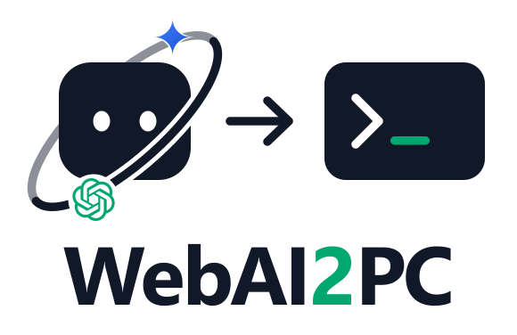
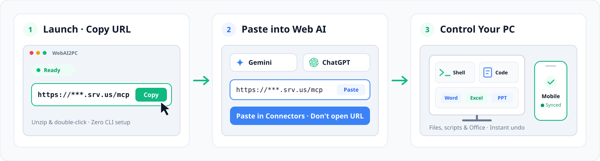

<div align="center">

<picture>
  <source media="(prefers-color-scheme: dark)" srcset="assets/brand/webai2pc-logo-dark.svg" />
  <source media="(prefers-color-scheme: light)" srcset="assets/brand/webai2pc-logo-light.svg" />
  
</picture>

<p><strong>Turn your existing Web Gemini / ChatGPT subscription into a local PC assistant · $0 extra API bills</strong></p>

<p>
  <a href="https://github.com/cosmosomo/WebAI2PC/releases"></a>
  <a href="LICENSE"></a>
  
  
</p>

<p><a href="README.md">简体中文</a> · <strong>English</strong> · <a href="docs/README.md">Docs Hub (docs/)</a></p>

</div>

<p align="center">
  <picture>
    <source media="(prefers-color-scheme: dark)" srcset="assets/readme/quickstart-flow-en-dark.svg" />
    <source media="(prefers-color-scheme: light)" srcset="assets/readme/quickstart-flow-en-light.svg" />
    
  </picture>
</p>

**WebAI2PC** is a local MCP (Model Context Protocol) server and visual control console for your computer. Paste the generated HTTPS URL into a custom connector in **Web Google Gemini** (including the same-account mobile Gemini App) or **Web ChatGPT** to read and edit local code, update Word / Excel / PPT files, and run terminal commands or Python scripts with zero extra API keys.

## 30-Second Quick Start

1. **Download & Extract**: Grab the package from [Releases](https://github.com/cosmosomo/WebAI2PC/releases) (`win64-full.zip` includes embedded Python for Windows; use the standard `.zip` for macOS, Linux, or existing Python 3.10+) and extract it to a regular folder.
2. **Launch & Copy URL**: Double-click `一键启动_Cosmos_MCP.bat` on Windows (or run `./start_cosmos_mcp.sh` on macOS / Linux). The local console opens at `http://127.0.0.1:8096/` with a ready-to-use `https://<domain>/mcp` endpoint.
3. **Paste & Allow in Web AI**:
   - **Web Gemini**: Go to `Customize -> Connectors -> + Custom`, paste `/mcp`, approve the local OAuth 2.1 prompt, and set `App actions` to `Always allow`. Start a chat with `@Cosmos`; your same-account mobile Gemini App syncs automatically.
   - **Web ChatGPT**: Go to `Settings -> Connectors`, add `/mcp` (Workspace accounts) or `/mcp/readonly` (Personal Plus / Pro accounts), and toggle it in the composer tool menu.

<details>
<summary><strong>Prefer guided setup? Copy this prompt to any Web Gemini or ChatGPT</strong></summary>

```text
Act as my WebAI2PC setup guide. First read the official setup guide at https://raw.githubusercontent.com/cosmosomo/WebAI2PC/main/docs/AI_SETUP_GUIDE.md, then walk me through setup one step at a time:
1. Ask my OS, whether I have already downloaded and extracted the release zip from https://github.com/cosmosomo/WebAI2PC/releases, and whether I want to connect Web Gemini or Web ChatGPT.
2. Guide me to launch the local console (http://127.0.0.1:8096/), copy the /mcp endpoint (/mcp/readonly for personal ChatGPT Plus/Pro), paste it into the custom connector, and complete OAuth 2.1 authorization.
3. Help me choose a workspace folder and security tier (L1–L4), and optionally upgrade to a permanent free Cloudflare Workers gateway (*.workers.dev/mcp).
Start by asking 3 short questions to check where I am.
```

</details>

## Key Capabilities & Local Guardrails

- **Code & Runtime**: Cross-file search, RepoMap indexing, targeted file patching, headless terminal & Python execution, plus automatic background handoff for long-running jobs.
- **Office & Multimodal**: Edit `.docx` (preserving layout) and `.xlsx` (preserving formulas with open-file lock protection); inspect local images and extract PDF / `.pptx` text.
- **3 Coexisting Gateways**: Zero-login instant URL (`*.srv.us` / `trycloudflare`), 3-second free Cloudflare Workers permanent URL (`*.workers.dev`), or your own 24/7 VPS hub.
- **4 Local Safety Guardrails**: `L1–L4` workspace isolation (parent read-only / child read-write layering), automatic pre-write snapshots with one-click `undo`, recoverable `.trash/` instead of hard deletes, and a Windows 4-color tray icon for instant read-only stop.

## Supported Web Hosts

| Web Host | Account Requirement | Endpoint |
| :- | :- | :- |
| **Web Google Gemini & Mobile App** | 18+ Google AI Pro / Ultra or Workspace with custom connectors enabled | `https://<domain>/mcp` (Full) |
| **Web ChatGPT (Workspace)** | Team / Business / Enterprise / Edu | `https://<domain>/mcp` (Full) |
| **Web ChatGPT (Personal)** | Personal Plus / Pro (read-only connectors only) | `https://<domain>/mcp/readonly` (Read-only) |

## Local Visual Console

<p align="center">
  
</p>

> Looking for the **architecture diagram, safety guardrails, full 16-tool reference, and mobile OAuth screenshots**? Open the **[Docs Hub (`docs/`)](docs/README.md)**.

## Documentation & Policies

- [Docs Hub (`docs/README.md`)](docs/README.md) — Step-by-step tutorials (01–05), architecture, and 16-tool reference
- [AI Setup Guide (`docs/AI_SETUP_GUIDE.md`)](docs/AI_SETUP_GUIDE.md) — Single-file guide for AI-assisted onboarding
- [AGENTS.md](AGENTS.md) · [host_skills/SKILL.md](host_skills/SKILL.md) · [PRIVACY.md](PRIVACY.md) · [SECURITY.md](SECURITY.md) · [CHANGELOG.md](CHANGELOG.md)

## License

Released under the [MIT License](LICENSE).
