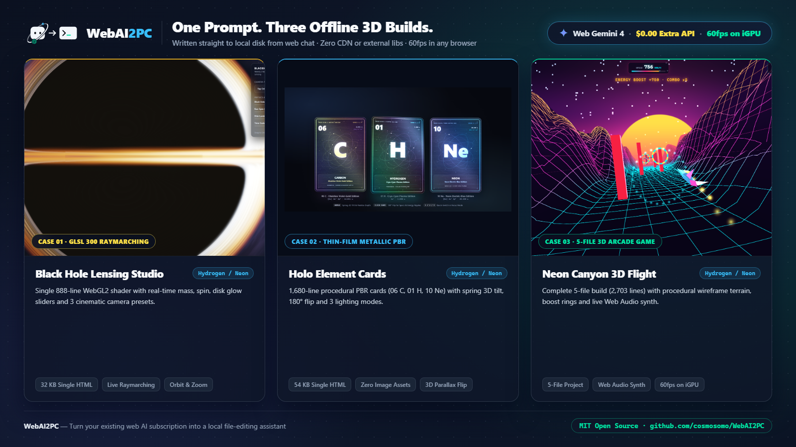
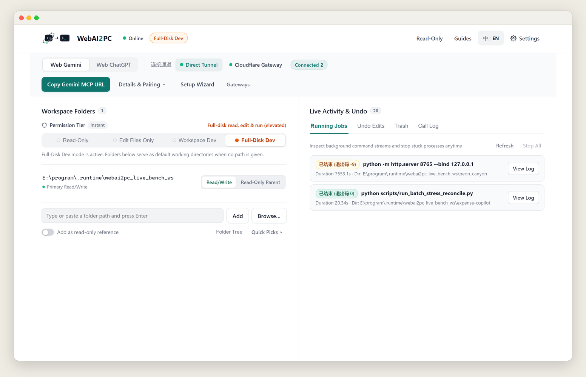

<div align="center">


<p><strong>Connect Web Gemini &amp; ChatGPT (even everyday Chat mode works as a local agent!) to your PC · Skip proxy &amp; Work/Codex quota hassles · $0 extra API bills</strong></p>

<p>
  <a href="https://github.com/cosmosomo/WebAI2PC/releases"></a>
  <a href="LICENSE"></a>
  
  
</p>

<p><a href="README.md">简体中文</a> · <strong>English</strong> · <a href="docs/en/README.md">Docs Hub (docs/en/)</a></p>

</div>

<p align="center">
  
  
</p>

> **AI Agent Setup Entry**: If you are an AI agent helping a user install or configure this repo (Cursor, Claude Code, Codex, Windsurf, WorkBuddy, etc.), read **[docs/en/AI_SETUP_GUIDE.md](docs/en/AI_SETUP_GUIDE.md)** first (Raw URL: `https://raw.githubusercontent.com/cosmosomo/WebAI2PC/main/docs/en/AI_SETUP_GUIDE.md`).

**WebAI2PC** is a local MCP (Model Context Protocol) server and visual control console for your computer. Paste the generated HTTPS URL into a custom connector in **Web Google Gemini** (including the same-account mobile Gemini App) or **Web ChatGPT** with `$0` extra API keys: once connected to Web ChatGPT, **even everyday `Chat` mode (alongside `Work` mode) directly runs multi-file local projects, edits Word / Excel files with formatting & formulas intact, extracts PPT structure/text, and runs tests without burning `Work / Codex` quota**.

## Why WebAI2PC

| Dimension | Desktop Clients / API Agents | WebAI2PC (Open Source) |
| :- | :- | :- |
| **Models & Cost** | Extra `$30–$100/mo` API keys or tight desktop quotas | **Reuse your existing web subscription** (Gemini 4, or ChatGPT Team/Business in `Chat` mode without burning `Work / Codex` quota), **`$0` extra API bills** |
| **Setup & Network** | Proxy issues, region blocks, env vars, session drops | **30-second double-click launch**; uses your OS built-in **OpenSSH** client (`Ed25519` local key + `SSHv2 ChaCha20-Poly1305 / AES-256-GCM` + `HTTPS/TLS` + `OAuth 2.1 PKCE`) to generate a persistent HTTPS URL with zero extra binaries or signup |
| **Local Execution** | Web `Chat` mode only pastes snippets (or burns `Work / Codex` quota), Office edits break layout | **Even everyday ChatGPT `Chat` mode runs multi-file local projects + preserves Office formatting/formulas + phone push** |
| **Safety Guardrails** | Broad disk access with risky deletes | **Single-folder sandbox · auto-snapshot undo · `.trash/` recovery · 0.1s tray read-only stop** |

## 30-Second Quick Start

1. **Download & Extract**: Grab the package from [Releases](https://github.com/cosmosomo/WebAI2PC/releases) (`win64-full.zip` includes embedded Python for Windows; use the standard `.zip` for macOS, Linux, or existing Python 3.10+) and extract it to a regular folder.
2. **Launch & Copy URL**: Double-click `一键启动_Cosmos_MCP.bat` on Windows (or run `./start_cosmos_mcp.sh` on macOS / Linux). The local console opens at `http://127.0.0.1:8096/` and invokes your OS built-in **OpenSSH** client (`Ed25519` local key + `SSHv2` encrypted tunnel + `HTTPS/TLS` + `OAuth 2.1 PKCE S256`) to generate a persistent login-free `https://<domain>/mcp` endpoint. (If Windows SmartScreen appears on first launch, click More info -> Run anyway.)
3. **Paste into Web AI Connectors & Allow** (**do NOT open the `/mcp` URL directly in your browser address bar; connection URLs and setup prompts copied from the console are strictly for your own signed-in AI accounts: do not screenshot or share them in group chats, forums, or public Issues**):
   - **Web Gemini**: Open [https://gemini.google.com/customize/connectors](https://gemini.google.com/customize/connectors) (or bottom-left menu `Personal Intelligence -> Connected Apps`), click `+ Custom`, paste `https://<domain>/mcp` into **`MCP Server URL`**, click `Next` to approve OAuth 2.1, then set `App actions` to `Always allow`. Start a chat with `@<your-connector-name>` (e.g., `@your-connector` or `@your-connector`); your same-account mobile Gemini App syncs automatically.
   - **Web ChatGPT (1-click in `Work` mode · `Chat` for daily coding)**: Once the gateway is ready in Studio, click **`Copy 1-Click Setup Prompt (for Work)`** (or the read-only button for Personal Plus / Pro) and paste it into ChatGPT `Work` mode so `@Plugin Creator` installs and verifies `WebAI2PC` over standard OAuth 2.1 (if your workspace admin disabled external MCP plugins, ask the admin to enable them or use a personal account). Once installed, both modes share `@<your-connector-name>` (default `@your-connector`): use everyday **`Chat` mode** for fast local coding, Office edits, and tests without burning `Work / Codex` quota, and use **`Work` mode** for multi-source deliverables and `Scheduled Tasks`, verifying first with `pc_get_status`.

### Let Your AI Agent Set It Up for You

Copy and send this one-liner to **Cursor, Claude Code, Codex, Windsurf, Trae, GitHub Copilot, Cline / Roo Code, Antigravity, Qoder, OpenCode, Doubao Work, WorkBuddy, OpenClaw, Manus, Web Gemini, or Web ChatGPT** (**local agents with shell access will clone the latest source, launch the service, and hand you the `/mcp` URL automatically; chat-only AIs will walk you through step by step**):

```text
Please install and configure https://github.com/cosmosomo/WebAI2PC from source for me. First read https://raw.githubusercontent.com/cosmosomo/WebAI2PC/main/docs/en/AI_SETUP_GUIDE.md . If you have local shell access, clone the latest source and start it to get my /mcp URL, then guide me step by step to connect Web Gemini or Web ChatGPT.
```

> Even if you only paste `https://github.com/cosmosomo/WebAI2PC` and say "set this up for me", the agent will spot [`docs/en/AI_SETUP_GUIDE.md`](docs/en/AI_SETUP_GUIDE.md) right at the top of the README. Note: once generated, keep your local connection URLs and setup prompts strictly inside your own signed-in AI accounts: never post screenshots or paste them into group chats, forums, or public Issues.

## Channel Dependencies & Proxy Notes

The local console includes 3 gateway cards (all supporting independent toggles for concurrent uptime). Check local dependencies, quotas, and regional proxy rules before choosing a channel:

| Channel | Local Runtime & Binary Dependencies | Cloud Account, Quotas & Timeouts | Network & Proxy Notes (incl. Mainland China) |
| :- | :- | :- | :- |
| **Channel 1 Primary: Built-in OpenSSH Direct Connect**<br>(`--mode openssh` · `*.srv.us` Fixed URL) | Invokes your OS built-in OpenSSH (`ssh`) client + outbound TCP port `22` only (zero extra binaries on Windows 10/11, macOS, and Linux); persistent local `Ed25519` key (private key stays local) + OpenSSH `SSHv2` (`ChaCha20-Poly1305` / `AES-256-GCM` + `curve25519-sha256`) encrypted reverse tunnel | Zero signup; `10s` startup wait budget; public `HTTPS/TLS` terminates at open-source `srv.us` edge and forwards over the `SSHv2` encrypted tunnel to a local ingress shim + `OAuth 2.1 PKCE S256` verification so the URL stays fixed across reboots (`scrypt + AES-256-GCM` PNG recovery card) | Connects **directly without a proxy** on typical Mainland China home broadband; Card 1 includes an independent backup toggle to run `*.trycloudflare.com` concurrently or when port `22` is blocked |
| **Channel 1 Backup: `*.trycloudflare.com`**<br>(Independent Toggle / `--mode cloudflare`) | Official `cloudflared` binary; if absent from `PATH`, auto-downloaded with SHA-256 verification on first launch from [GitHub Releases](https://github.com/cloudflare/cloudflared/releases/latest) or `COSMOS_CLOUDFLARED_MIRROR` HTTPS mirror into state `bin/` | Zero signup, **URL changes on every restart**; [no uptime SLA](https://developers.cloudflare.com/tunnel/get-started/quick-tunnels/), single control stream (`ha-connections:1`) with `4–21s` reconnect gaps (HTTP `530`/`1033`), `200` max concurrent requests, `125s` edge read timeout | In Mainland China without a proxy, GitHub downloads may be slow: enable a system proxy, set `COSMOS_CLOUDFLARED_MIRROR`, or pre-install `cloudflared`; enabling a local HTTP proxy reduces disconnects on lossy cross-border links |
| **Channel 2: `Cloudflare Dedicated Fixed Gateway`**<br>(`workers_dev`) | Pure Python stdlib `443 WSS` client, **zero external binary dependencies** (no `Node.js`, `wrangler`, or `cloudflared`) | Free Cloudflare account + one-time least-privilege API Token (zero-overwritten and shredded locally right after deploy); subject to [Workers Free](https://developers.cloudflare.com/workers/platform/limits/) `100,000` req/day cap (Error `1027`) and [default `125s` edge read timeout](https://developers.cloudflare.com/support/troubleshooting/http-status-codes/cloudflare-5xx-errors/error-524/) | **In Mainland China, default `*.workers.dev` suffers full DNS pollution (`100%` direct timeout): without a custom domain, keep a local HTTP/HTTPS proxy (Clash / Mihomo / v2rayN, or `HTTPS_PROXY` / `WSS_PROXY`) continuously open with rules covering `*.workers.dev`** (browser `/consent` login also requires proxying `*.workers.dev`; keep `127.0.0.1,localhost,::1` in `NO_PROXY` if set). **Mainland proxy-free option**: bind an Active Zone Custom Domain on the same Cloudflare account |
| **Channel 3 Primary: 24h Cloud Server Hub**<br>(`vps_hub` / `vps`) | Local `ssh` client + a Linux server with ports `80`/`443` open | Uses your own server; **zero Cloudflare dependency, zero daily request cap, zero `125s` edge timeout**, stays online `24/7` when PC is off | **100% proxy-free direct connection** on Mainland China (with ICP-filed domain) or HK/SG servers |
| **Channel 3 Sub-option: `Cloudflare Named Tunnel`**<br>(`--mode cloudflare_token`) | Official `cloudflared` binary (same auto-download or `COSMOS_CLOUDFLARED_MIRROR` support) | Cloudflare Zero Trust account + Active Zone domain + Public Hostname route pointing to `http://127.0.0.1:8096`; `125s` edge read timeout | Avoids `workers.dev` DNS pollution; disable `Bot Fight Mode` and skip WAF managed challenges on `/mcp*` and OAuth paths in Cloudflare so Google / OpenAI cloud requests are not blocked |

> For full setup walkthroughs and troubleshooting, see **[Gateway Selection & Network Troubleshooting Guide (`docs/en/04_gateways_and_troubleshooting.md`)](docs/en/04_gateways_and_troubleshooting.md)**.

## One-Shot Local Showcase · Copy & Run

<p align="center"></p>

With zero external textures, libraries, or CDNs, prepend `@<your-connector-name> ` (e.g., `@your-connector ` or ``) in Web Gemini or everyday Web ChatGPT `Chat` mode (`$0` extra API bills and zero `Work / Codex` quota usage) to generate and run these offline WebGL2 projects at 60fps directly inside your local workspace folder:

| Case | Local Output | What Runs Locally at 60fps |
| :- | :- | :- |
| **01 Black Hole Gravitational Lensing** | Single file `blackhole_studio.html` | Raw WebGL2 (GLSL 300) real-time raymarching with glowing accretion disk & Einstein ring, 3 camera presets, and 4 live physics sliders |
| **02 Periodic Table Holo Cards** | Single file `gemini_holo_cards.html` | Procedural Canvas + WebGL2 thin-film interference metallic foil for `06 C / 01 H / 10 Ne`, spring 3D tilt, 180° flip, and 3 lighting presets |
| **03 Neon Canyon 3D Low-Altitude Flight** | 5-file project `neon_canyon/` | Generates `index.html`, `styles.css`, `terrain.js`, `audio.js`, and `game.js` with synthwave wireframe canyon, boost rings, Web Audio synth SFX, and keyboard/mouse flight |

<details>
<summary><strong>Click to expand 1-click copyable prompts (type <code>@</code> to pick your connector in chat, then paste and send)</strong></summary>

**01 Black Hole Gravitational Lensing (`blackhole_studio.html`)**

```text
Build a pure offline single-file blackhole_studio.html in the current workspace using raw WebGL2 (GLSL 300) real-time raymarching to render a black hole with a glowing accretion disk and gravitational lensing; add left-drag orbit and wheel zoom, plus a clean translucent control panel with 3 camera presets (Top Disk / Skim Horizon / Ring Flyby) and 4 real-time sliders (mass, spin, disk brightness, time scale), then launch and verify zero console errors locally.
```

**02 Periodic Table Holo Cards (`gemini_holo_cards.html`)**

```text
Build a pure offline single-file gemini_holo_cards.html in the current workspace using raw WebGL2 and procedural Canvas to render 3 thin-film interference metallic 3D collector cards for 06 C (Carbon), 01 H (Hydrogen), and 10 Ne (Neon); include spring 3D hover tilt and parallax, click-to-flip 180 degrees, a top toggle between Row Spread and Single Focus, and 3 ambient color-temperature presets with zero external images or CDNs, then open and verify locally.
```

**03 Neon Canyon 3D Low-Altitude Flight (`neon_canyon/`)**

```text
Create a neon_canyon folder in the current workspace with a 5-file structure (index.html, styles.css, terrain.js, audio.js, game.js) for a pure offline raw WebGL2 3D low-altitude flight game: synthwave sunset and neon wireframe canyon, boost/combo energy rings, red hazard pylons and canyon walls, real-time Web Audio engine and ring SFX, automatic WASD/arrow and mouse steering switch, HUD for score/high score/combo/airspeed/FPS plus pause and restart buttons, then run and verify zero console errors locally.
```

> Type `@` to select your connector in Web Gemini or Web ChatGPT, then paste and send.

</details>

## Supported Web Hosts

| Web Host | Account Requirement & Mode Split | Endpoint |
| :- | :- | :- |
| **Web Google Gemini & Mobile App** | 18+ Google AI Pro / Ultra or Workspace with custom connectors enabled | `https://<domain>/mcp` (Full) |
| **Web ChatGPT (Workspace)** | Team / Business / Enterprise / Edu (1-click setup via `Work` mode prompt; daily `@your-connector` in `Chat` uses zero `Work / Codex` quota, `Work` for multi-app & scheduled tasks) | `https://<domain>/mcp` (Full) |
| **Web ChatGPT (Personal)** | Personal Plus / Pro (when custom MCP servers are restricted to `read/fetch`; shared across `Chat` & `Work` once installed) | `https://<domain>/mcp/readonly` (Read-only) |

## Local Visual Console

<p align="center">
  
</p>

> Looking for the **architecture diagram, safety guardrails, full 16-tool reference, and mobile OAuth screenshots**? Open the **[Docs Hub (`docs/en/`)](docs/en/README.md)**.

## Documentation & Policies

- [Docs Hub (`docs/en/README.md`)](docs/en/README.md) — Step-by-step tutorials (01–05), architecture, and 16-tool reference
- [AI Setup Guide (`docs/en/AI_SETUP_GUIDE.md`)](docs/en/AI_SETUP_GUIDE.md) — Single-file guide for AI-assisted onboarding
- [AGENTS.md](AGENTS.md) · [host_skills/SKILL.md](host_skills/SKILL.md) · [PRIVACY_EN.md](PRIVACY_EN.md) · [SECURITY_EN.md](SECURITY_EN.md) · [CHANGELOG.md](CHANGELOG.md)

## License

Released under the [MIT License](LICENSE).
