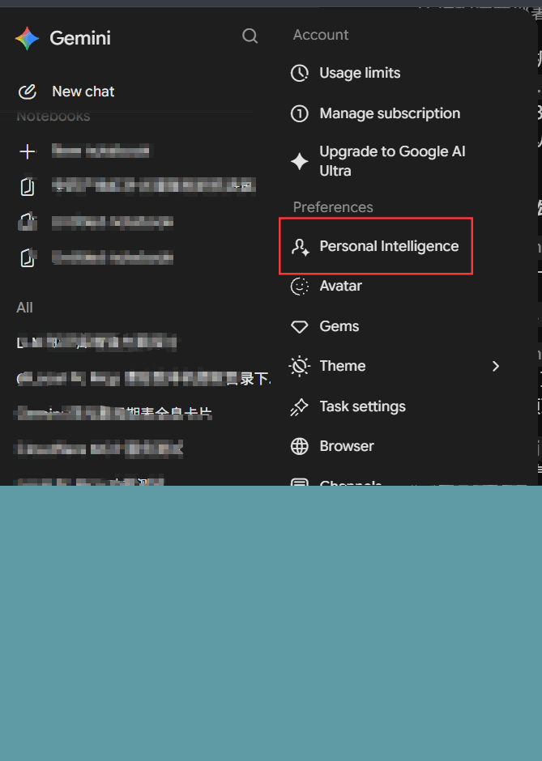
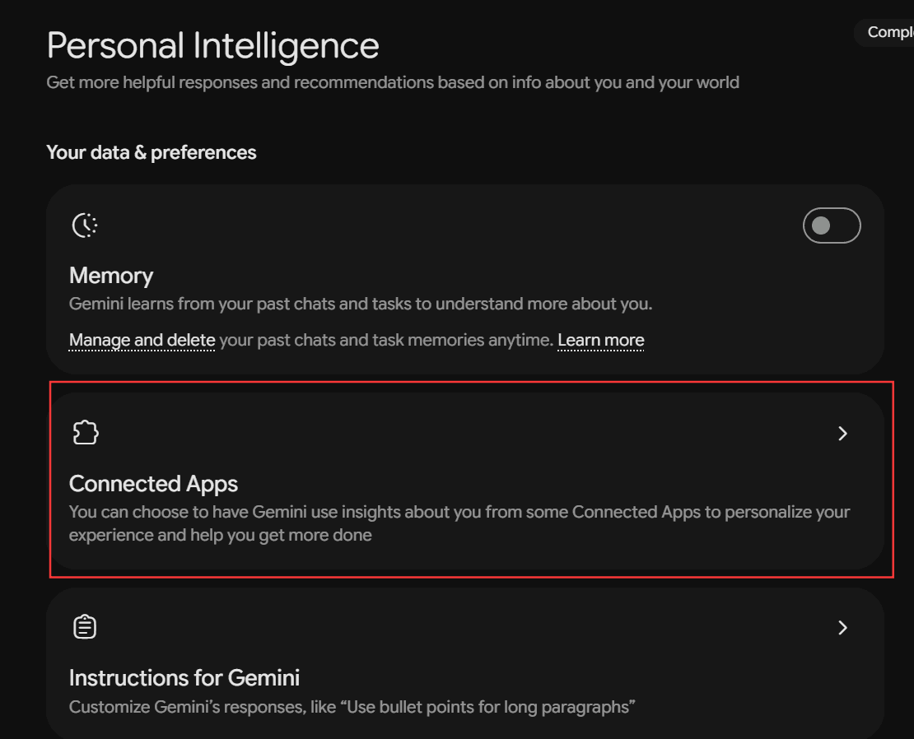

# 01. 网页版 Gemini 与手机远程连接教程

本教程按**默认免登录模式**从头到尾带你 30 秒连上 **网页版 Google Gemini（含同账号手机端 Gemini App）**。默认模式不用注册第三方账号、不用敲命令行；Cloudflare 固定网址、自有云服务器与多设备进阶配置放在后半部分，新手可以先跳过。

> 启动本地服务后，也可直接打开本地交互式教程页 `http://127.0.0.1:8096/tutorials` 一键复制当前生效地址。若要连接 **网页版 ChatGPT**，请看 [02. 网页版 ChatGPT 工作区与个人只读接入教程](02_网页版ChatGPT工作区与个人只读接入教程.md)。

---

## 一、默认模式：30 秒连上网页版 Gemini（推荐先按这里做）

### 第 1 步：完整解压并双击启动，复制 `/mcp` 地址

1. 前往 [Releases 发布页](https://github.com/cosmosomo/WebAI2PC/releases) 下载发行包（Windows 免装 Python 选 `win64-full.zip`，已装 Python 3.10+ 或 macOS / Linux 选标准 `zip`），**先完整解压缩到普通文件夹**（不要在压缩包预览窗口里直接双击）。
2. 启动本地控制台：
   - **Windows**：双击 `一键启动_Cosmos_MCP.bat`
   - **macOS / Linux**：在终端运行 `./start_cosmos_mcp.sh`
3. 浏览器会自动打开本地控制台 `http://127.0.0.1:8096/`，默认直接开启 **「系统内置 OpenSSH 免登录直连」**：直接调用电脑系统自带的 OpenSSH（`ssh`）客户端与本机持久 `Ed25519` 密钥（私钥留存本机不上传），建立 `SSHv2`（`ChaCha20-Poly1305 / AES-256-GCM`）加密反向隧道并经 `srv.us` 公共中继连接免登录固定网址（如 `https://xxxxx.srv.us/mcp`，公网 `HTTPS/TLS` + 本地隔离垫片与 `OAuth 2.1 PKCE S256` 二次鉴权，零额外安装，启动等待预算 `10` 秒，重启电脑网址不变），卡片内同时提供备用临时通道 `https://*.trycloudflare.com/mcp` 独立开关（可与 OpenSSH 固定通道同时在线，或在网络封禁 `22` 端口时启用）。
4. 确认顶部选中 **「网页版 Gemini」**，点击蓝色按钮 **「复制连接地址」**。

### 第 2 步：把 `/mcp` 地址粘贴到 Gemini 连接器配置栏

> **重要提醒**：刚才复制的 `https://<你的域名>/mcp` **不是用来直接在浏览器地址栏里打开访问的网址**，而是要粘贴到下面 Gemini 连接器页面的 **`MCP Server URL`** 配置栏里。

1. **进入 Gemini 连接器页面（两种方式等价，推荐直接点链接）**：
   - **直达地址（推荐）**：直接打开 [https://gemini.google.com/customize/connectors](https://gemini.google.com/customize/connectors)
   - **手动点击路径**：打开网页版 Gemini -> 点击左下角菜单 -> 在 `Preferences` 下点击 **`Personal Intelligence`** -> 点击 **`Connected Apps`**，即可进入 `Connectors` 页面。

   | 第 1 步：左下角菜单进入 `Personal Intelligence` | 第 2 步：点击 `Connected Apps` |
   | :-: | :-: |
   |  |  |

2. **点击 `+ Custom` 并粘贴地址**：
   - 在 `Connectors` 页面右上角点击 **`+ Custom`**。
   - 在弹出的 **`Connect to an MCP server`** 窗口中，把控制台复制的 `https://<你的域名>/mcp` 粘贴到 **`MCP Server URL`** 配置栏（`Additional settings` 保持默认折叠，无需填写 Client ID / Secret），点击 **`Next`**。

   | 第 3 步：点击右上角 `+ Custom` | 第 4 步：粘贴到 `MCP Server URL` 配置栏点 `Next` |
   | :-: | :-: |
   |  |  |

### 第 3 步：点击允许，并开启免审批总开关

1. 跳转到本地授权确认页后，同一台电脑的浏览器会自动核验同机身份，直接点击 **「本机一键允许连接（免输口令）」** 即可完成绑定（若在手机或另一台电脑上授权，展开本地控制台 `配对与已连会话` 填入 6 位动态配对码）。
2. **开启免审批总开关（避免每次弹窗点确认）**：回到 [https://gemini.google.com/customize/connectors](https://gemini.google.com/customize/connectors) 点开刚添加的连接器，将 **`App actions`** 总开关设为 **`Always allow（始终允许）`**。
   - 请勿在聊天对话流弹出的单张工具确认卡片上单独点允许，单卡点击会按单工具粒度覆盖并导致其余工具退回逐次确认。
3. **可选导入操作守则**：在本地控制台点击「复制 AI 操作守则（推荐存入 Skills）」（或复制仓库 `host_skills/SKILL.md` 全文），保存到网页版 Gemini 的 `Skills` 设置中，可减少 AI 误操作。

### 第 4 步：发第一句话验证（手机端自动同步）

1. 在网页版 Gemini 新建对话，输入框首句输入 `@你在连接器里填写的名称`（例如 `@WebAI2PC` 或 `@Cosmos`）并选中弹出的连接器标签，发送：
   ```text
   @WebAI2PC 帮我看看当前工作目录里有哪些文件
   ```
   （授权刚完成时，控制台顶部绿色横幅和 Windows 托盘右键菜单都提供「复制首句唤醒词」，可直接粘贴发送。）
2. **手机端免配置同步**：电脑端绑定完成后，登录同一 Google 账号的 Android / iOS 手机端 Gemini App 会自动同步该连接器，外出时直接发 `@你在连接器里填写的名称 ...` 即可远程让家中电脑干活。

---

## 二、接入条件与常见注意点（连不上时看这里）

- **网页版 Google Gemini 账号条件**：需年满 `18+` 周岁的 Google AI Pro 或 Ultra 订阅账号，或已由管理员开启自定义连接器权限的 Google Workspace 账号（免费个人 Google 账号暂未开放自定义连接器入口）。
- **临时地址说明**：默认模式首选走 `*.srv.us` 固定网址（`10` 秒启动等待预算，重启不变）；若所在网络拦截 `22` 端口而启用了卡片内的备用 `*.trycloudflare.com` 临时通道，电脑关机重启后该临时域名会变化，届时可在控制台恢复 `*.srv.us` 固定网址，或升级到下文「进阶连接方式」里的 Cloudflare 免费固定网址。
- **网页版 ChatGPT 用户**：工作区账号（Team / Business / Enterprise / Edu）用 `/mcp`，个人 Plus / Pro 账号受平台限制写工具时用 `/mcp/readonly`；详细步骤与 `Work` / `Chat` 模式分工见 [02. 网页版 ChatGPT 工作区与个人只读接入教程](02_网页版ChatGPT工作区与个人只读接入教程.md)。

---

## 三、手机远控、防休眠与多设备协同

1. **手机远程控机与笔记本防休眠**：
   - 使用免登录固定网址（或下文 Cloudflare / 自有服务器固定网址）并开启开机自启后，手机端发送长耗时任务（如跑测试、打包）会自动转后台运行。
   - Windows 笔记本插电时默认开启防休眠保持在线；拔电用电池时自动解除防休眠，开盖唤醒或切换网络后约 1.5 秒内自动重连。
2. **多台电脑同时接入（`tool_prefix`）**：
   - 单台电脑保持默认 `pc` 即可；多台电脑接入同一对话时，可在控制台「设置 -> 工具与扩展」设置不同的 `tool_prefix`（如 `desk`、`laptop`），在同一聊天窗口分别调用 `desk_read_file` 与 `laptop_run_python`。

---

## 四、进阶连接方式（默认模式够用时可跳过）

控制台「设置 -> 连接与网关」（`http://127.0.0.1:8096/#settings/gateways`）内 3 张连接卡片右上角均带独立开关，**支持多路网关同时在线**，配置新通道时不会断开当前已连会话（完整排障见 [04. 三大连接通道选型与网络排障手册](04_三大连接通道选型与网络排障手册.md)）：

### 方式 2：Cloudflare 免费 3 秒终身固定网址（推荐长期稳定使用）

适合没有自有服务器与域名、希望网址终身固定且不依赖 22 端口的用户：
1. 打开控制台 `#settings/gateways`，展开第 2 张卡片 **「Cloudflare 专属固定网关」**，点击预填好最小权限的 Cloudflare 令牌创建链接并登录账号。
2. 生成 API 令牌后复制粘贴回控制台输入框（有托管在 Cloudflare 的自有域名也可一并选填），点击 **「一键部署并开启（约 3 秒）」**。
3. 后台自动认领 `*.workers.dev` 子域并部署免费休眠中继网关，生成固定地址 `https://<子域>.workers.dev/mcp`；部署完成瞬间 API 令牌立即从内存和磁盘清零销毁。
4. 后续只需拨动卡片开关即可启停，电脑重启、休眠唤醒或切热点自动通过 443 端口重连，网页端连接器地址终身无需重填。

### 方式 3：自有云服务器 24 小时主站 或 自有固定域名

适合已有 Linux 云服务器或自有域名的用户：
1. **一键部署 24 小时云服务器主站**：展开第 3 张卡片，填写服务器公网 IP 与 SSH 密码（仅当次内存使用不落盘）或本地 SSH 私钥，点击一键部署。部署后单个连接器默认通过 `target="auto"` 自动按路径路由到云服务器或本地电脑；本地电脑关机期间，云服务器仍 24 小时在线可用。
2. **绑定自有固定域名（命令行 / 反向代理）**：

<details>
<summary>展开查看命令行启动与自有域名示例</summary>

```bash
# 默认模式指定工作区启动
cosmos-mcp start --workspace D:\Projects\my-app

# Cloudflare Named Tunnel 固定域名
cosmos-mcp start --mode cloudflare_token --tunnel-token <粘贴你的TOKEN> --public-url https://mcp.example.com --autostart

# 自有 VPS 反向代理 / SSH 反向映射
cosmos-mcp start --mode vps --vps-ssh user@vps.example.com --vps-remote-port 18096 --public-url https://mcp.example.com --autostart
```

</details>
