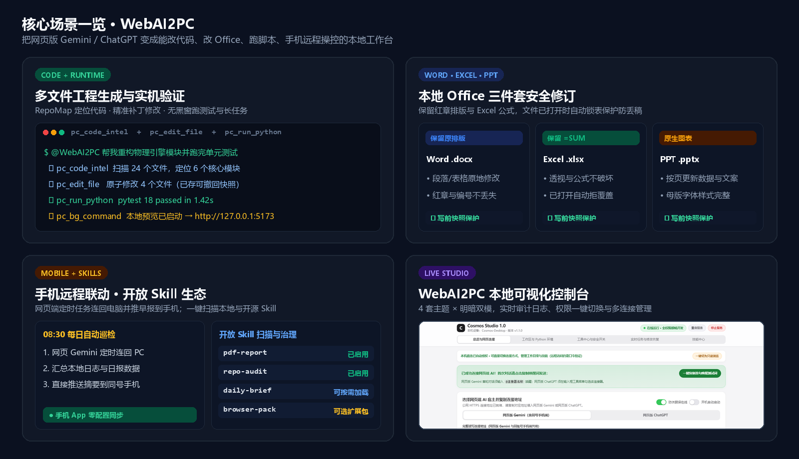
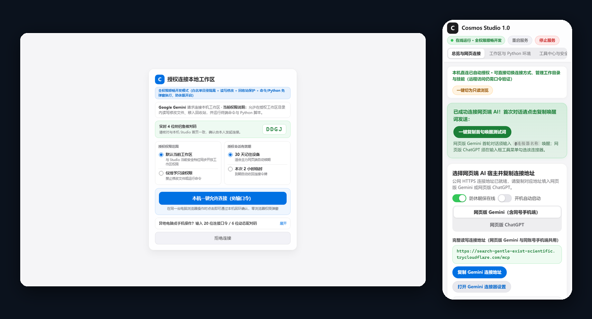

# WebAI2PC 文档中心

> 🌐 **Language:** 简体中文（当前） · [English Documentation](en/README.md)

本目录存放 **WebAI2PC** 的二级实操教程、连接架构说明、安全护栏与内置工具参考。

> 返回项目首页：[README.md](../README.md) · 前往下载发行包：[Releases](https://github.com/cosmosomo/WebAI2PC/releases)

## 1. 分场景实操教程

| 教程 | 适合人群与核心内容 |
| :- | :- |
| [01. 网页版 Gemini 与手机远程连接教程](01_网页版Gemini与手机远程连接教程.md) | 零命令行解压启动、3 类网关独立开关、Gemini 任务模式 `Always allow` 设置与同号手机端同步控机 |
| [02. 网页版 ChatGPT 工作区与个人只读接入教程](02_网页版ChatGPT工作区与个人只读接入教程.md) | `Work` 模式首次代连与 `Chat` 模式零智能体额度日常控机分工，及工作区 `/mcp` 与个人只读 `/mcp/readonly` 配置步骤 |
| [03. 本地控制台面板与扩展包指南](03_Cosmos_Studio面板与扩展包指南.md) | 本地控制台五大功能页、4 档安全模式、父只读 / 子读写目录分层、受管浏览器与桌面扩展包、Docker 与 Windows Sandbox |
| [04. 三大连接通道选型与网络排障手册](04_三大连接通道选型与网络排障手册.md) | 免登录固定通道（`srv.us` / `trycloudflare`）、Cloudflare 3 秒终身固定网关、自有 VPS 主站部署与排障 |
| [05. 多智能体并行子任务与实战工作流教程](05_多智能体并行子任务与实战工作流教程.md) | 宿主 Skills 守则导入、Gemini 并行子任务分工、Office 安全修订与后台长任务轮询 |
| [AI 陪配单文件教程（AI_SETUP_GUIDE.md）](AI_SETUP_GUIDE.md) | 专供网页版 Gemini / ChatGPT 直接读取的完整陪配步骤 |

## 2. 连接原理与宿主边界

  
  

## 3. 安全兜底机制

  
  

## 4. 核心场景与同机授权界面

  

  

## 5. 默认 16 项内置工具速查

默认工具前缀为 `pc_`（多设备接入可在控制台或通过 `--tool-prefix` 热修改），另有默认关闭、按需热开启的 `browser`（受管浏览器 `pc_browser_use`）与 Windows `desktop`（后台窗口操控 `pc_cua_window`）两套可选扩展包：

| 工具名称 | 类别 | 功能说明 |
| :- | :- | :- |
| `pc_get_status` | 只读查询 | 查看系统信息、工作目录、安全档位，支持轮询后台任务 |
| `pc_find_files` | 只读查询 | 按通配符、扩展名、目录深度查找工作区文件 |
| `pc_search_code` | 只读查询 | 跨文件正则或字面量检索代码与结构化文档 |
| `pc_code_intel` | 代码理解 | 工程 RepoMap、符号大纲、定义与引用追踪、作用域重命名 |
| `pc_read_file` | 只读查询 | 分段读代码、直看本地图片、提取 PDF / `.docx` / `.xlsx` / `.pptx` |
| `pc_batch_probe` | 只读查询 | 受限只读沙盒内单次运行确定性 Python 聚合探针 |
| `pc_web_research` | 只读查询 | 本地执行公开网页与 GitHub 代码检索 |
| `pc_skill_hub` | 只读查询 | 检索工作区与受管技能库（默认隔离外部全局技能目录） |
| `pc_edit_file` | 文件修改 | 代码补丁替换、`.docx` 保留排版修改、`.xlsx` 单元格修改（带锁表保护与写前快照） |
| `pc_write_file` | 文件修改 | 新建或写入文件（写前快照 + 语法检查） |
| `pc_manage_files` | 文件管理 | 目录与文件操作（删除进 `.trash/` 回收箱，支持 `undo` / `redo`） |
| `pc_workspace_memory` | 协作记录 | 跨会话工作区交接记录读写 |
| `pc_skill_manage` | 技能管理 | 受控目录内增删改本地 `SKILL.md` 技能 |
| `pc_run_command` | 命令运行 | 后台无窗口执行终端命令，超时自动转后台任务 |
| `pc_run_python` | 命令运行 | 通过标准输入直接运行多行 Python 代码 |
| `pc_bg_command` | 命令运行 | 启动、查状态、等待、读尾部日志或终止后台长耗时任务 |

## 6. 工程与安全规范

- [项目架构与维护规范（AGENTS.md）](../AGENTS.md)
- [宿主操作守则模板（host_skills/SKILL.md）](../host_skills/SKILL.md)
- [隐私政策与零遥测声明（PRIVACY.md）](../PRIVACY.md)
- [安全架构与漏洞反馈（SECURITY.md）](../SECURITY.md)
- [版本变更记录（CHANGELOG.md）](../CHANGELOG.md)
