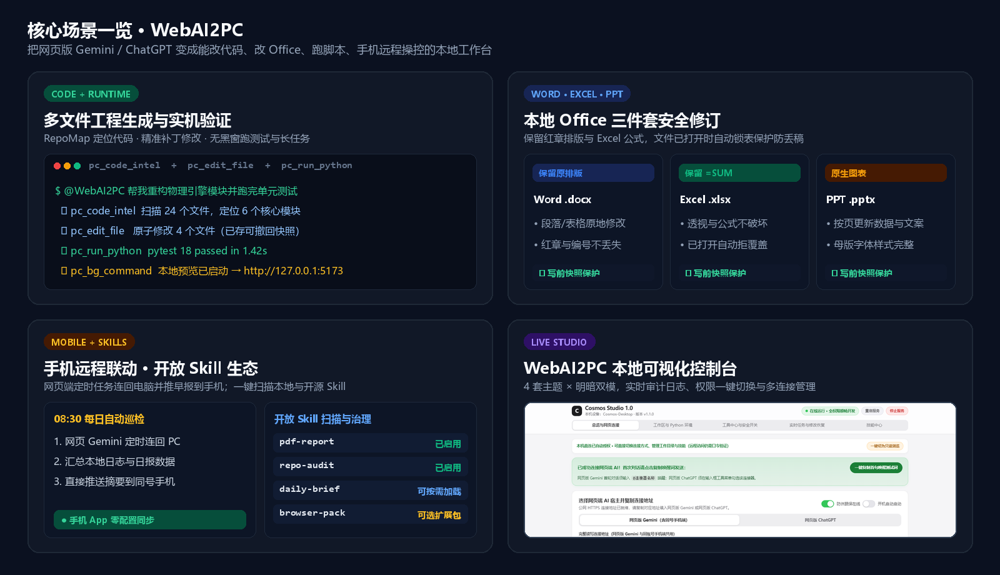
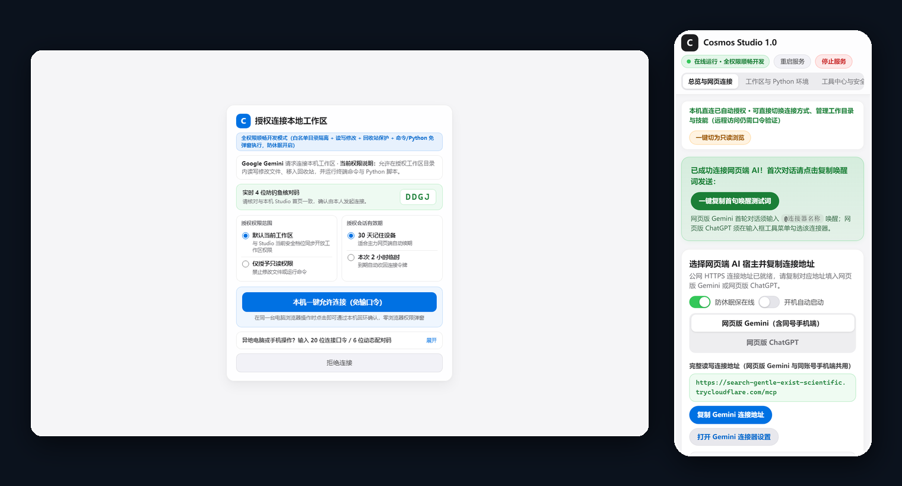

# WebAI2PC Documentation Hub

**English** | [简体中文](../README.md) · [Back to README_EN](../../README_EN.md) · [Releases](https://github.com/cosmosomo/WebAI2PC/releases)

This directory hosts **WebAI2PC**'s step-by-step tutorials, connection architecture diagrams, safety guardrails, and built-in tool references.

## 1. Scenario-Based Tutorials

| Tutorial | Audience & Core Topics |
| :- | :- |
| [01. Web Gemini & Mobile Remote Connection Guide](01_web_gemini_and_mobile.md) | Zero-CLI extract & launch, 3 independent gateway switches, Gemini Task Mode `Always allow` setup, and same-account mobile remote control |
| [02. Web ChatGPT Workspace & Personal Read-Only Guide](02_web_chatgpt_workspace_and_readonly.md) | `Work` mode first-time assisted setup vs `Chat` mode zero-agent-quota daily execution, plus Workspace `/mcp` and Personal `/mcp/readonly` configuration |
| [03. Cosmos Studio Console & Extension Packs Guide](03_studio_console_and_extensions.md) | Five console pages, 4 security tiers, parent read-only / child read-write directory layering, managed browser & desktop packs, Docker & Windows Sandbox |
| [04. Three Connection Channels & Network Troubleshooting ](04_gateways_and_troubleshooting.md) | Zero-login persistent tunnel (`srv.us` / `trycloudflare`), Cloudflare 3-second permanent gateway, self-hosted VPS hub deployment & troubleshooting |
| [05. Multi-Agent Parallel Subtasks & Practical Workflows ](05_multi_agent_workflows.md) | Host Skills rule import, Gemini parallel subtask delegation, safe Office revisions, and background long-task polling |
| [AI Guided Setup Single-File Tutorial (`AI_SETUP_GUIDE.md`) ](AI_SETUP_GUIDE.md) | Complete step-by-step guide designed to be read directly by Web Gemini / ChatGPT |

## 2. Connection Architecture & Host Boundaries

  
  

## 3. Safety Guardrail Mechanisms

  
  

## 4. Core Scenarios & Local OAuth Consent UI

  

  

## 5. Quick Reference: 16 Default Built-In Tools

The default tool prefix is `pc_` (for multi-device setups, you can hot-change it in the console or via `--tool-prefix`). Two optional extension packs are disabled by default and can be hot-enabled on demand: `browser` (managed browser `pc_browser_use`) and Windows `desktop` (background window control `pc_cua_window`):

| Tool Name | Category | Description |
| :- | :- | :- |
| `pc_get_status` | Read-only | Inspect system info, workspace directory, security tier, and poll background jobs |
| `pc_find_files` | Read-only | Find workspace files by glob pattern, extension, or directory depth |
| `pc_search_code` | Read-only | Search code and structured documents across files via regex or literal text |
| `pc_code_intel` | Code Intel | Project RepoMap, symbol outline, definition/reference lookup, scoped symbol rename |
| `pc_read_file` | Read-only | Read code by line ranges, view local images directly, extract PDF / `.docx` / `.xlsx` / `.pptx` |
| `pc_batch_probe` | Read-only | Run a single deterministic Python aggregation probe inside a restricted read-only sandbox |
| `pc_web_research` | Read-only | Run local public web and GitHub code searches |
| `pc_skill_hub` | Read-only | Search workspace and managed skill libraries (isolates external global skill directories by default) |
| `pc_edit_file` | File Edit | Patch code replacements, format-preserving `.docx` edits, `.xlsx` cell edits (with lock protection & pre-edit snapshots) |
| `pc_write_file` | File Edit | Create or write files (pre-edit snapshot + syntax validation) |
| `pc_manage_files` | File Mgmt | Directory & file operations (deletions move to `.trash/`, supports `undo` / `redo`) |
| `pc_workspace_memory` | Collab Log | Read and write cross-session workspace handoff notes |
| `pc_skill_manage` | Skill Mgmt | Create, edit, or remove local `SKILL.md` skills inside controlled directories |
| `pc_run_command` | Execution | Run windowless terminal commands in the background; auto-promotes to background job on timeout |
| `pc_run_python` | Execution | Execute multi-line Python code directly via stdin pipe |
| `pc_bg_command` | Execution | Start, check status, wait, read tail logs, or kill long-running background jobs |

## 6. Engineering & Security Policies

- [Project Architecture & Maintenance Specification (`AGENTS.md`)](../../AGENTS.md)
- [Host Operational Rules Template (`host_skills/SKILL.md`)](../../host_skills/SKILL.md)
- [Interface Design System (`.interface-design/system.md`)](../../.interface-design/system.md)
- [Privacy Policy & Zero-Telemetry Statement (`PRIVACY_EN.md`)](../../PRIVACY_EN.md)
- [Security Architecture & Vulnerability Reporting (`SECURITY_EN.md`)](../../SECURITY_EN.md)
- [Changelog (`CHANGELOG.md`)](../../CHANGELOG.md)
